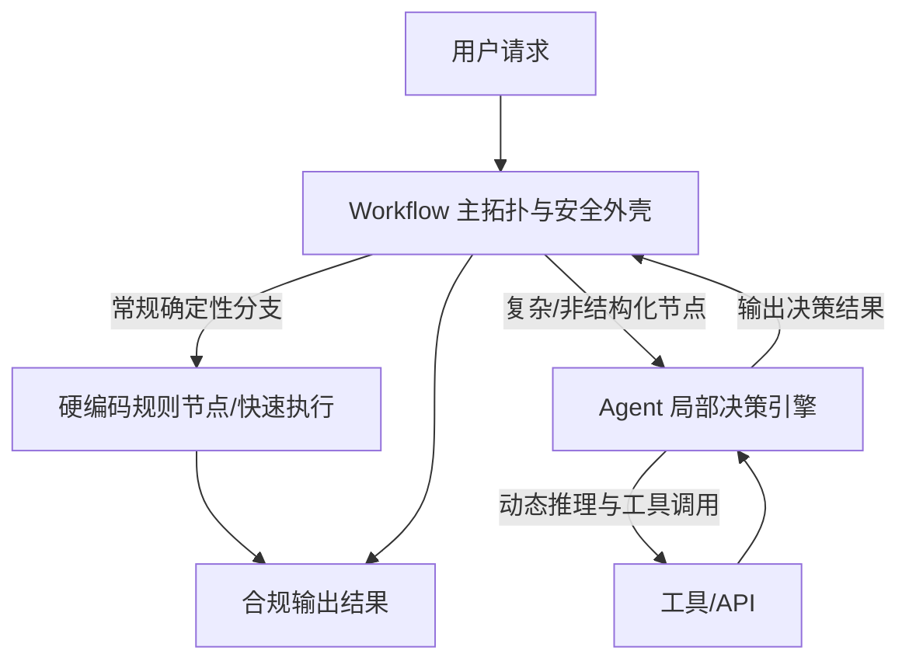

## 1 概念边界

* **Workflow（工作流）**：
  * *机制*：预先定义任务节点、分支条件和执行拓扑。
  * *控制权*：路径由开发者或业务规则决定。
  * *表现*：流程稳定、可预测，适合明确业务。
* **Agent（智能体）**：
  * *机制*：LLM 根据目标和环境反馈，动态拆解任务、选择工具并决定下一步。
  * *控制权*：局部或全局路径由模型运行时决定。
  * *表现*：灵活度高，但结果、调用次数和延迟更不稳定。

## 2 典型案例

### 2.1 旅游推荐

* **Workflow 方案**：
  * *机制*：预设晴天、雨天等天气分支，再调用对应景点 API。
  * *风险*：未覆盖“大风”“霾”等状态时会走默认分支或不合理路径。
* **Agent 方案**：将查询 API 暴露给 Agent 作为工具。Agent 理解天气与出行体验的内在联系，当获取到“大风”时，自主推理出“不宜高空或湖面项目”，从而主动推荐遮风避风的室内展馆。
  * *限制*：模型可能误判天气影响或调用错误工具，需要工具校验和结果审核。

### 2.2 电商退款审批

* **Workflow 方案**：根据硬编码规则过滤（7 天内且金额小于 100 元自动退款；100 至 500 元人工客服审核；大于 500 元拒绝）。规则明确、响应快速、成本极低且合规可控，但过于死板，无法识别恶意黑产退货，也无法对忠诚用户的合理超期诉求给予人性化处理。
* **Agent 方案**：由 Agent 阅读退款政策、调取用户消费信用、分析聊天凭证与商品照片，自主评估风险并决策。能处理充满上下文的复杂诉求，但成本较高且存在概率性输出导致的判决一致性问题。
* **Workflow + Agent 融合方案**：工作流作为外壳处理明确规则（小额自动退款、违禁品直接驳回）；当遇到复杂争议或模糊文本描述时，将节点路由给 Agent 进行深度推理与处置。
  * *关键边界*：Agent 只输出建议或中间判断；退款、拒绝等资金动作仍由确定性规则或人工审批执行。

## 3 融合架构：控制流与自主性的统一

现代工业级架构普遍采用 **Workflow 定边界与主拓扑 + Agent 作局部决策引擎** 的融合范式，既保障了主流程的可控性与高效性，又获得了局部节点的灵活性。

## 4 架构选型指南

### 4.1 优先选择 Workflow

* **高确定性与高合规要求**：财务核算、医疗处方开具、合同法律条款审批等不允许概率性差错的场景。
* **高频低延迟业务**：高频交易、秒杀抢购、自动化日志过滤等对毫秒级响应要求极高的地方。
* **标准化业务流程**：步骤明确、规则多年未变的自动化流水线。

### 4.2 优先选择 Agent

* **目标明确但路径模糊**：如“编写竞品分析报告”、“自动调试报错代码”，需要跨工具探索与规划。
* **非结构化与充满上下文的信息**：智能客服复杂投诉处理、个性化行程定制、非标准文档解析。
* **需要与动态环境交互**：需要根据外部 API 返回结果随时调整后续步骤的自动化场景。

### 4.3 判断顺序

1. 能完整枚举步骤、分支和异常吗？能则优先 Workflow。
2. 业务是否包含大量未结构化信息或未知分支？是则考虑局部 Agent。
3. 错误结果是否会造成资金、权限或合规风险？是则增加确定性校验和人工审批。
4. 能否记录完整轨迹并量化成功率、成本和延迟？不能则不扩大 Agent 自主权。
5. 先用 Workflow 建立基线，再只把真正无法规则化的节点交给 Agent。
