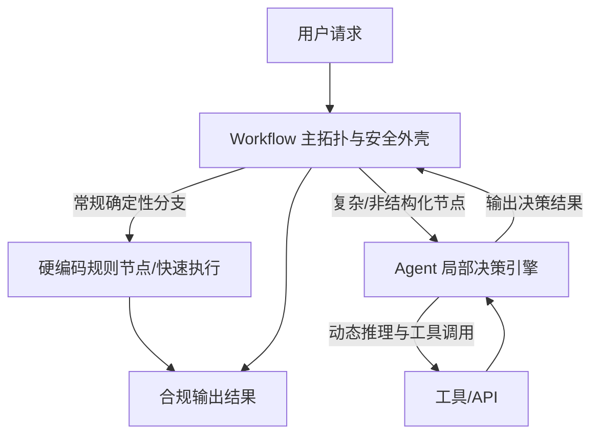

### 1. 本质差异
* **Workflow（工作流）**：让 AI 按部就班地执行指令。核心是对一系列任务或步骤进行预先定义、结构化的静态编排（if/else 逻辑），由人类显式规划路径，AI 仅作为节点执行工具。
* **Agent（智能体）**：赋予 AI 自由度去自主达成目标。以目标为导向，LLM 作为决策大脑理解环境、推理、动态拆解任务并选择工具。由人类给定终点目标，AI 自主规划路径。

| 对比维度    | Workflow（工作流）       | Agent（智能体）                |
| :------ | :------------------ | :------------------------ |
| 核心机制    | 预定义节点、分支逻辑与静态拓扑     | 感知-思考-行动-观察闭环 |
| 控制流决策者  | 人类开发者（硬编码规则 / 流程图）  | 大语言模型（LLM 动态推理）           |
| 确定性与灵活度 | 高确定性、低灵活度           | 低确定性（概率性）、高灵活度            |
| 任务拆解能力  | 静态设定，无法应对未预见的场景     | 动态拆解，根据实时反馈随时修正子目标        |
| 工具调用机制  | 固定在指定步骤调用固定 API     | 根据思考自主选择工具与参数    |
| 异常处理能力  | 依赖预设的异常分支           | 具备自我反思与重新规划能力             |
| 计算与时间成本 | 执行速度快，开销极低且稳定       | 耗费多轮 LLM Token，延迟相对较高     |
| 合规与审计性  | 路径完全透明，100% 可预测、易审计 | 决策过程存在概率性，审计复杂度高          |
### 2. 经典案例对比

#### 案例一：旅游查询与推荐服务
* **Workflow 方案**：必须硬编码完整分支逻辑（如：若天气为晴天则查户外景点，雨天则查室内博物馆）。若天气 API 返回“大风”或“霾”等未预设条件，工作流将直接崩溃或走入默认错误分支。
* **Agent 方案**：将查询 API 暴露给 Agent 作为工具。Agent 理解天气与出行体验的内在联系，当获取到“大风”时，自主推理出“不宜高空或湖面项目”，从而主动推荐遮风避风的室内展馆，展现出极强的泛化与抗干扰能力。

#### 案例二：电商售后退款申请处理
* **Workflow 方案**：根据硬编码规则过滤（7 天内且金额小于 100 元自动退款；100 至 500 元人工客服审核；大于 500 元拒绝）。规则明确、毫秒级响应、成本极低且合规可控，但过于死板，无法识别恶意黑产退货，也无法对忠诚用户的合理超期诉求给予人性化处理。
* **Agent 方案**：由 Agent 阅读退款政策、调取用户消费信用、分析聊天凭证与商品照片，自主评估风险并决策。能处理充满上下文的复杂诉求，但成本较高且存在概率性输出导致的判决一致性问题。
* **Workflow + Agent 融合方案**：工作流作为外壳处理 80% 的明确规则（小额自动退款、违禁品直接驳回）；当遇到复杂争议或模糊文本描述时，将节点路由给 Agent 进行深度推理与处置。

### 3. 融合架构：控制流与自主性的统一

现代工业级架构普遍采用 **Workflow 定边界与主拓扑 + Agent 作局部决策引擎** 的融合范式，既保障了主流程的可控性与高效性，又获得了局部节点的灵活性。

### 5. 架构选型指南

#### 优先选择 Workflow 的场景
* **高确定性与高合规要求**：财务核算、医疗处方开具、合同法律条款审批等不允许概率性差错的场景。
* **高频低延迟业务**：高频交易、秒杀抢购、自动化日志过滤等对毫秒级响应要求极高的地方。
* **标准化业务流程**：步骤明确、规则多年未变的自动化流水线。

#### 优先选择 Agent 的场景
* **目标明确但路径模糊**：如“编写竞品分析报告”、“自动调试报错代码”，需要跨工具探索与规划。
* **非结构化与充满上下文的信息**：智能客服复杂投诉处理、个性化行程定制、非标准文档解析。
* **需要与动态环境交互**：需要根据外部 API 返回结果随时调整后续步骤的自动化场景。