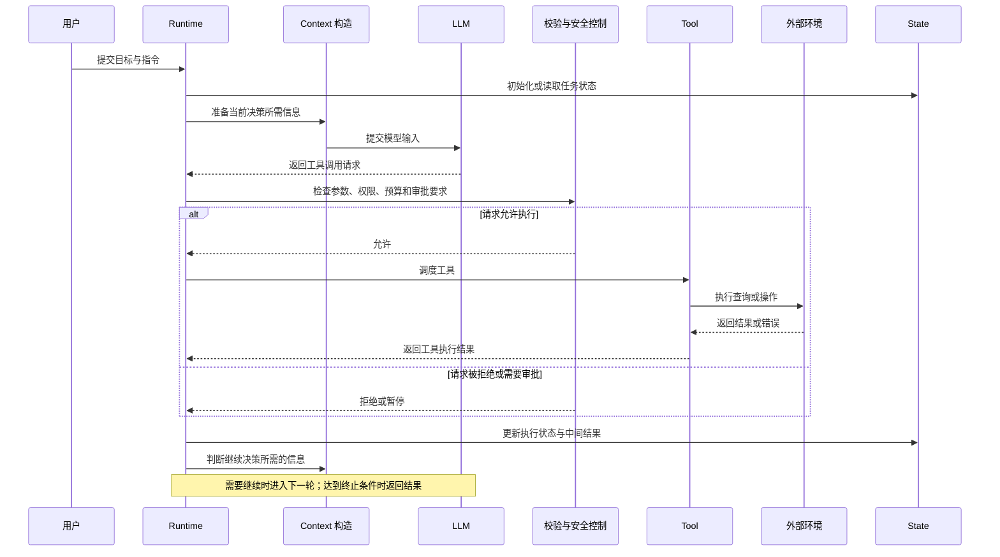

## 1 Agent 与 Workflow 的边界

### 1.1 定义

* **Workflow（工作流）**：
  * *机制*：预先定义任务节点、分支条件和执行拓扑。
  * *控制权*：路径由开发者或业务规则决定。
  * *表现*：流程稳定、可预测，适合边界明确的业务。
* **Agent（智能体）**：
  * *机制*：LLM 根据目标和环境反馈，动态拆解任务、选择工具并决定下一步。
  * *控制权*：局部或全局路径由模型在运行时决定。
  * *表现*：灵活度高，但结果、调用次数和延迟更不稳定。

**常见误区**：
* Workflow 也可以调用 LLM，区别不在是否使用 AI，而在控制流由谁决定。
* Agent 也可以包含固定节点，权限校验、支付和发布等高风险步骤应保持确定性。
* 两者不是非此即彼，生产系统常用Workflow 负责边界、主流程和高风险动作；Agent 负责路径无法完全枚举、需要上下文判断的局部节点。
### 1.2 选型顺序

1. 能完整枚举步骤、分支和异常吗？能则优先 Workflow。
2. 是否包含大量未结构化信息、未知分支或动态环境？是则考虑局部 Agent。
3. 错误结果是否会造成资金、权限或合规风险？是则增加确定性校验和人工审批。
4. 能否记录完整轨迹并量化成功率、成本和延迟？不能则不扩大 Agent 自主权。
5. 先用 Workflow 建立基线，再只把真正无法规则化的节点交给 Agent。

* **优先 Workflow**：高确定性、高合规、高频低延迟、流程稳定。
* **优先 Agent**：目标明确但路径模糊、非结构化上下文复杂、需要与动态环境交互。
# 2 Agent 定义与运行要素

### 2.1 Agent 定义：

AI Agent（智能体）以 LLM 为核心决策组件，能够感知环境、作出决策、执行动作、获取反馈并持续调整行动。
### 2.2 抽象公式

**Agent = Goal + LLM Decision + Action + Observation + Loop**
* **Goal（目标驱动）**：定义任务需要实现的结果、约束条件和完成标准。目标可以由用户直接提出，也可以由上层工作流分配。
* **LLM Decision（决策引擎）**：模型根据目标、指令、当前上下文和执行状态，判断下一步应采取什么行动，或者任务是否已经完成。
* **Action（行动执行）**：Agent 根据决策提出行动请求，例如调用工具、查询数据库、读取文件，或者向用户请求补充信息。模型提出工具调用请求并不代表操作已经执行。
* **Observation（环境观察）**：获取工具执行结果、错误信息及环境状态变化，为下一轮决策提供依据。
* **Loop（闭环循环）**：将决策、行动、观察和状态更新组织为循环，使 Agent 能够根据执行结果继续行动、调整方案、重新规划或终止任务。
### 2.3 Agent System 组成

```text
Agent System（智能体系统）
│
├── Goal & Instructions（目标与指令）
│   ├── 任务目标
│   ├── 行为规则
│   └── 约束条件
│
├── LLM（大语言模型）
│   ├── 理解任务
│   ├── 判断下一步行动
│   └── 生成回答或工具调用请求
│
├── Context & State（上下文与状态）
│   ├── 当前输入与必要历史
│   ├── 已执行的行动与结果
│   └── 当前任务状态
│
├── Tools（工具）
│   ├── 搜索与 RAG
│   ├── 数据库与 API
│   └── 文件系统与代码执行
│
├── Runtime（运行时）
│   ├── 调用模型
│   ├── 解析并调度行动
│   ├── 管理执行循环
│   └── 控制暂停、恢复与终止
│
├── Guardrails（安全与约束）
│   ├── 参数与权限校验
│   ├── 风险操作审批
│   └── 资源与执行限制
│
└── Environment（外部环境）
    ├── 文件系统
    ├── 数据库与业务系统
    └── 网络服务及其状态
```

## 3 Agent System 核心组件

![[agent架构图.png]]

### 3.1 五个基础组件

**（1）LLM：决策能力**

LLM 负责对自然语言与上下文进行语义理解，生成判断、行动请求或最终回答。

**（2）Runtime：运行时与执行控制**

Runtime 是让 Agent 真正运行起来的控制程序。它把模型、工具和任务状态连接起来，管理整个执行过程。可以将它理解为执行协调器，而不是产生全部智能决策的组件。

在典型的 Agent Loop 中，Runtime 会负责以下工作：

* 准备当前请求所需的模型输入。
* 调用 LLM，接收模型响应。
* 判断响应是最终回答，还是包含工具调用请求。
* 对工具调用进行必要的参数、权限及安全检查。
* 调度工具执行，并获取执行结果。
* 将执行结果加入后续处理所需的消息或状态。
* 根据流程条件决定继续调用模型、暂停还是终止任务。

**（3）Tools：可调用的外部能力**

Tools 是 Agent 与外部系统交互的接口。一个 Tool 往往由工具描述、输入参数结构和实际执行函数组成。

* **信息检索**：Web Search、RAG 知识库检索；补充模型未掌握的实时或私有信息。
* **数据访问**：SQL 查询、业务系统 API；读写外部结构化数据。
* **计算执行**：Python 代码执行器、确定性计算器；执行数学计算或确定性逻辑。
* **文件操作**：文件读写、文档生成；操作本地或云端文件系统。
* **业务操作**：工单创建、邮件发送、支付接口；改变外部业务系统的实际状态。

**（4）Context：当前决策所需的信息**

在 Agent 中，模型输入所需的上下文可能包括：

* 系统指令与任务要求。
* 用户当前的问题。
* 与当前决策有关的历史消息。
* 当前任务中已经执行的操作及其结果。
* 从 RAG 知识库检索得到的相关文档。
* 可调用工具的描述及其参数结构。

**（5）State：当前任务状态**

State（状态）是程序管理的结构化数据，用于记录任务目前进行到了哪里、已经获得什么结果，以及还有哪些事情需要完成。State 还可能包含当前计划、已完成的步骤、工具执行结果、错误计数、待处理任务及审批状态等。

State 是任务状态管理的基础；Context 是为当前决策提供的信息集合。程序可以根据 State 构造 Context，但两者并不等同。
### 3.2 组件划分不是固定标准

**（1）三个抽象层次**

* **运行闭环**：Goal → Decision → Action → Observation → Loop，是 Agent 能够持续行动的功能要求。
* **基础实现**：LLM、Runtime、Tools、Context、State，是最小可用 Agent 的常见工程拆分。
* **可选能力**：Planner、Memory、Evaluator、Guardrails、Orchestrator 等，按任务复杂度增加。

**（2）Planner：规划职责**

* *机制*：把目标拆解为多个步骤、依赖关系和完成标准。
* *独立实现*：使用单独模型或节点生成计划，再由 Executor 逐步执行。
* *隐式实现*：LLM 每轮直接决定下一步，此时规划能力包含在 LLM Decision 中。
* *判断依据*：任务依赖复杂、需要全局计划或分工时，再显式拆分 Planner。

规划范式的进一步分类见 [[05_Agent 决策范式与编排选型]]。

**（3）Memory：跨会话信息管理**

* *机制*：持久化、检索、更新和遗忘跨任务信息。
* *典型内容*：用户偏好、历史结论、可复用经验和长期知识。
* *与 State 的区别*：State 管理当前任务进展；Memory 管理可跨任务保留的信息。
* *与 Context 的区别*：Memory 是存储与检索对象；Context 是本轮实际送入模型的材料。
* *判断依据*：一次性任务通常不需要独立 Memory，多会话个性化任务才需要。

Memory 设计详见 [[04_记忆系统与工程]]。

**（4）Evaluator：结果校验职责**

* *机制*：根据规则、测试、Schema 或评价标准判断结果是否合格。
* *实现方式*：LLM 评审、程序校验、单元测试、人工审批或规则引擎。
* *反馈循环*：评估失败后，把问题反馈给 Agent，形成“生成 → 评估 → 修正”。
* *独立性*：可以单独作为评审节点，也可以成为 Runtime 的后置检查。

评测设计详见 [[_自动化评测]]。

**（5）实现粒度的判断**

* 简单客服 Agent：可能只需要 LLM、Tools 和 Runtime，State 只保存会话与重试次数。
* 研究报告 Agent：可能需要 Planner 拆解任务、Memory 保存中间资料、Evaluator 检查引用。
* 多 Agent 系统：还可能增加 Orchestrator、Worker 和 Critic，不能由此反推出所有 Agent 都必须具备这些模块。
### 3.3 一次工具调用的运行过程



### 3.4 限制 Agent 自主性的分层控制

限制 Agent 自主性不能只靠 System Prompt。应采用分层控制：

* **指令层**：说明任务目标、行为规则和禁止事项。
* **Runtime 层**：设置最大执行步数、超时、预算、工具调用校验、审批流程与终止条件。
  * 工具访问控制：决定 Agent 可以使用哪些工具，哪些工具调用必须被拒绝。
  * 参数与权限检查：校验调用参数、用户权限和操作目标，避免模型生成的请求越过业务边界。
  * 最大执行步数：防止 Agent 不断循环、重复调用工具。
  * 超时、Token 与成本预算：避免长时间运行、请求失控或资源耗尽。
  * 人工审批机制：对删除文件、写入生产数据库、部署等高风险操作要求人工确认。
  * 终止与恢复控制：满足完成条件时结束任务，遇到异常时停止、重试或暂停等待处理。
* **工具与服务层**：校验参数、身份、资源范围和业务权限。
* **基础设施层**：通过最小权限、目录隔离、沙箱和网络限制，约束实际可执行的操作。
## 4 Agent Loop

### 4.1 定义与运行主体

![[Agent Loop流程.png]]

Agent Loop 是 Agent 在运行期间反复进行模型调用、处理行动请求、执行工具、获取结果并决定下一步的控制循环。即模型决策 → Runtime 调度 → 工具执行 → 观察结果 → 更新信息 → 再次决策。
循环的主体由 Runtime 控制。LLM 决定本轮输出什么，Runtime 根据响应类型决定执行哪个分支。
### 4.3 终止条件与工程底线

循环必须有明确的结束条件，不能只依赖模型自己判断什么时候应该停止。
工程底线：循环必须具有明确的终止机制，并配置合适的次数限制、超时、预算和异常处理。

**（1）常见终止条件**

* **正常完成**：模型生成符合要求的最终输出，系统返回结果。
* **达到执行上限**：超过允许的模型调用轮次或执行步数，终止或返回受控错误。
* **超时或预算耗尽**：任务超过时间或 Token 预算，停止执行。
* **安全检查不通过**：请求违反权限策略，拒绝执行或暂停等待审批。
* **工具或模型异常**：API 超时、工具报错或输出格式无效时，按规则重试、处理异常或终止。
* **用户取消任务**：用户主动取消后，停止后续操作。

**（2）运行链路**

![[agent运行链路.png]]
