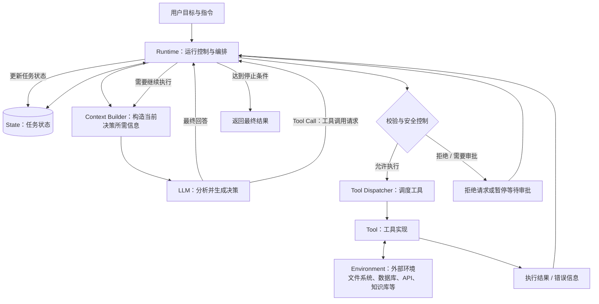
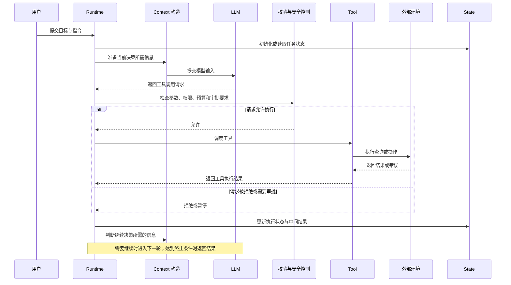

## 1 定义
### 1.1 核心定义
AI Agent（智能体）是以 LLM（大语言模型）为核心大脑，能够感知环境、决策、实际执行、获取反馈、持续调整行动的运行机制的系统。
### 1.2 底层抽象公式
#### 1.2.1 公式一：Agent = Model + Harness
智能体由模型大脑与外围控制系统共同构成：
* **Model（模型大脑）**：作为核心算力与通用知识库，负责意图理解、逻辑推理、自然语言表达以及工具调用决策。
* **Harness（智能系统操作层/运行时）**：围绕模型构建的确定性外围控制机制，包括提示词工程、上下文管理、工具系统、记忆组件以及安全防护与降级逻辑。
#### 1.2.2 公式二：Agent = Goal + LLM Decision + Action + Observation + Loop
智能体运行的要素闭环：
* **Goal（目标驱动）**：定义任务需要实现的结果、约束条件和完成标准。目标可以由用户直接提出，也可以由上层工作流分配。
* **LLM Decision（决策引擎）**：模型根据目标、指令、当前上下文和执行状态，判断下一步应采取什么行动，或者任务是否已经完成。
* **Action（行动执行）**：Agent 根据决策提出行动请求，例如调用工具、查询数据库、读取文件，或者向用户请求补充信息。模型提出工具调用请求并不代表操作已经执行。
* **Observation（环境观察）**：获取工具执行结果、错误信息及环境状态变化，为下一轮决策提供依据。
* **Loop（闭环循环）**：将决策、行动、观察和状态更新组织为循环，使 Agent 能够根据执行结果继续行动、调整方案、重新规划或终止任务。
### 1.3 Agent System 的组成结构
```text
Agent System（智能体系统）
│
├── Goal & Instructions（目标与指令）
│   ├── 任务目标
│   ├── 行为规则
│   └── 约束条件
│
├── LLM（大语言模型）
│   ├── 理解任务
│   ├── 判断下一步行动
│   └── 生成回答或工具调用请求
│
├── Context & State（上下文与状态）
│   ├── 当前输入与必要历史
│   ├── 已执行的行动与结果
│   └── 当前任务状态
│
├── Tools（工具）
│   ├── 搜索与 RAG
│   ├── 数据库与 API
│   └── 文件系统与代码执行
│
├── Runtime（运行时）
│   ├── 调用模型
│   ├── 解析并调度行动
│   ├── 管理执行循环
│   └── 控制暂停、恢复与终止
│
├── Guardrails（安全与约束）
│   ├── 参数与权限校验
│   ├── 风险操作审批
│   └── 资源与执行限制
│
└── Environment（外部环境）
    ├── 文件系统
    ├── 数据库与业务系统
    └── 网络服务及其状态
```
## 2 Agent 基本架构
![[agent架构图.png]]
### 2.1 五个核心组件
#### 2.1.1 LLM：决策能力
LLM 负责对自然语言与上下文进行语义理解，生成判断、行动请求或最终回答。
#### 2.1.2 Runtime：运行时与执行控制
Runtime 是让 Agent 真正运行起来的控制程序。它把模型、工具和任务状态连接起来，管理整个执行过程。可以将它理解为执行协调器，而不是产生全部智能决策的组件。
在典型的 Agent Loop 中，Runtime 会负责以下工作：
* 准备当前请求所需的模型输入。
* 调用 LLM，接收模型响应。
* 判断响应是最终回答，还是包含工具调用请求。
* 对工具调用进行必要的参数、权限及安全检查。
* 调度工具执行，并获取执行结果。
* 将执行结果加入后续处理所需的消息或状态。
* 根据流程条件决定继续调用模型、暂停还是终止任务。
#### 2.1.3 Tools：可调用的外部能力
Tools 是 Agent 与外部系统交互的接口。一个 Tool 往往由工具描述、输入参数结构和实际执行函数组成。

|工具类型|典型示例|核心作用|
|---|---|---|
|信息检索|Web Search、RAG 知识库检索|补充模型未掌握的实时或私有信息|
|数据访问|SQL 查询、业务系统 API|读写外部结构化数据|
|计算执行|Python 代码执行器、确定性计算器|执行精准数学计算或确定性逻辑|
|文件操作|文件读写、文档生成|操作本地或云端文件系统|
|业务操作|工单创建、邮件发送、支付接口|改变外部业务系统的实际状态|
#### 2.1.4 Context：当前决策所需的信息
在 Agent 中，模型输入所需的上下文可能包括：
* 系统指令与任务要求。
* 用户当前的问题。
* 与当前决策有关的历史消息。
* 当前任务中已经执行的操作及其结果。
* 从 RAG 知识库检索得到的相关文档。
* 可调用工具的描述及其参数结构。
#### 2.1.5 State：当前任务状态
State（状态）是程序管理的结构化数据，用于记录任务目前进行到了哪里、已经获得什么结果，以及还有哪些事情需要完成。State 还可能包含当前计划、已完成的步骤、工具执行结果、错误计数、待处理任务及审批状态等。
#### 2.1.6 Context 与 State 的对比
|对比维度|Context|State|
|---|---|---|
|核心问题|模型当前需要知道什么？|程序当前处于什么状态？|
|主要目的|为当前决策提供适当信息|记录和管理任务进展|
|典型内容|用户输入、相关历史、检索资料、工具描述|执行步骤、结果集合、任务状态、待审批标记|
|是否会变化|会随每次调用需要的信息变化|会随任务执行而更新|
|是否全部交给 LLM|不一定，通常只提供相关部分|不一定，可能只有部分状态被选入模型输入|
State 是任务状态管理的基础；Context 是为当前决策提供的信息集合。程序可以根据 State 构造 Context，但两者并不等同。
### 2.2 系统架构图

> 图示说明：这是帮助理解职责分工的概念架构，不要求每个系统都实现为独立模块。实际框架可能把 Context 构造、状态管理、权限校验和工具调度封装在不同对象或中间件中。
### 2.3 一次工具调用的运行过程

### 2.4 限制 Agent 自主性的分层控制
限制 Agent 自主性不能只靠 System Prompt。应采用分层控制：
* **指令层**：说明任务目标、行为规则和禁止事项。
* **Runtime 层**：设置最大执行步数、超时、预算、工具调用校验、审批流程与终止条件。
  * 工具访问控制：决定 Agent 可以使用哪些工具，哪些工具调用必须被拒绝。
  * 参数与权限检查：校验调用参数、用户权限和操作目标，避免模型生成的请求越过业务边界。
  * 最大执行步数：防止 Agent 不断循环、重复调用工具。
  * 超时、Token 与成本预算：避免长时间运行、请求失控或资源耗尽。
  * 人工审批机制：对删除文件、写入生产数据库、部署等高风险操作要求人工确认。
  * 终止与恢复控制：满足完成条件时结束任务，遇到异常时停止、重试或暂停等待处理。
* **工具与服务层**：校验参数、身份、资源范围和业务权限。
* **基础设施层**：通过最小权限、目录隔离、沙箱和网络限制，约束实际可执行的操作。
## 3 Agent Loop
### 3.1 定义与运行主体
![[Agent Loop流程.png]]
Agent Loop 是 Agent 在运行期间反复进行模型调用、处理行动请求、执行工具、获取结果并决定下一步的控制循环。
循环的主体由 Runtime 控制。LLM 决定本轮输出什么，Runtime 根据响应类型决定执行哪个分支。
### 3.2 运行步骤
* 第 1 步，准备输入：程序为模型准备本轮决策需要的信息，包括任务指令、用户问题、相关历史消息、可用工具描述，以及必要的执行结果。
* 第 2 步，调用 LLM，获得本轮输出：模型根据当前输入产生响应。
* 第 3 步，Runtime 处理行动请求：Runtime 接到请求后，需要确定所请求的工具是否存在、参数是否符合要求、当前操作是否被允许，然后决定是否调度工具执行。
* 第 4 步，执行 Tool，获得 Observation：Observation（观察）就是执行后得到的信息，包括成功结果、错误信息或环境状态变化。它并不一定是自然语言，也可以是结构化数据、文件内容、HTTP 响应或测试结果。
* 第 5 步，更新状态与上下文：执行完工具之后，程序需要把相关结果交给后续流程处理。
* 第 6 步，重新调用 LLM，决定继续还是停止：形成闭环，即模型决策 → Runtime 调度 → 工具执行 → 观察结果 → 更新信息 → 再次决策。
### 3.4 终止条件与工程底线
循环必须有明确的结束条件，不能只依赖模型自己判断什么时候应该停止。
工程底线：循环必须具有明确的终止机制，并配置合适的次数限制、超时、预算和异常处理。
#### 3.4.1 常见终止条件
|终止条件|例子|系统处理|
|---|---|---|
|正常完成|模型生成符合要求的最终输出|返回结果|
|达到执行上限|超过允许的模型调用轮次或执行步数|终止或返回受控错误|
|超时或预算耗尽|任务超过时间或 Token 预算|停止执行|
|安全检查不通过|请求违反权限策略|拒绝执行或暂停等待审批|
|工具或模型异常|API 超时、工具报错、输出格式无效|按规则重试、处理异常或终止|
|用户取消任务|用户主动取消正在运行的任务|停止后续操作|

agent运行链路：
[[agent运行链路.png]]

agent知识信息图：
[[agent知识图谱.png]]