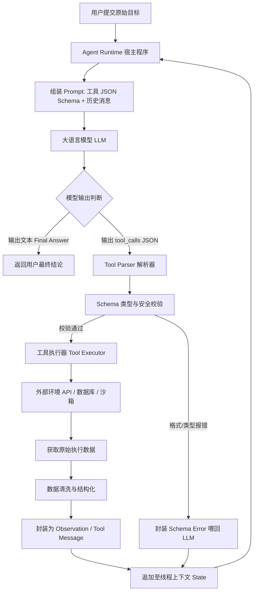
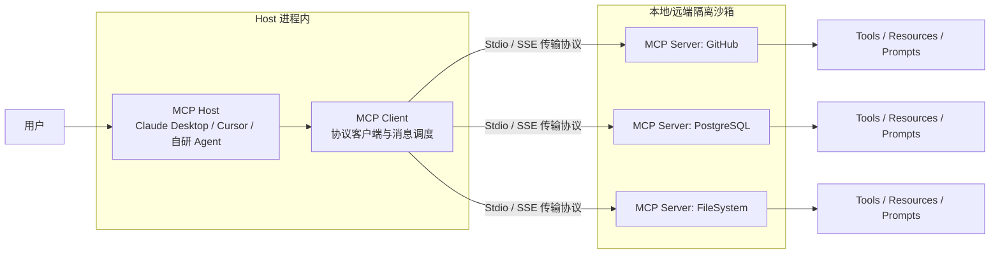

![[Tool Calling知识图谱.png]]

## 1 Tool Calling 核心概念
### 1.1 核心术语定义
* **Function（函数）**：真正执行业务逻辑的具体程序代码块。
* **Tool（工具）**：向 Agent 暴露的可调用能力接口，是 Function 的外层封装。
* **Tool Schema（工具模式/定义）**：使用标准化结构（通常为 JSON Schema）严格描述工具的名称、功能用途、入参数据类型、约束条件及返回格式。
* **Tool Call（工具调用指令）**：LLM（大语言模型）根据需求自动生成的结构化数据（通常为 JSON 格式），表达“请求调用某工具并传入指定参数”的决策意图。
* **Agent Runtime（智能体运行时）**：负责接收并解析 Tool Call、校验参数合法性、安全执行具体 Function、捕获执行结果并驱动 Agent Loop 持续流转的宿主程序。
* **Tool Result / Observation（工具执行结果）**：工具实际物理运行后产出的原始数据或状态反馈，回填至 LLM 上下文中供其进行下一步推理与决策。
### 1.2 Tool Schema 的核心组成要素
Tool Schema 是 LLM 与程序代码之间的**接口契约**。一个完整的 Tool 由以下五部分抽象构成：
* **Name（名称）**：工具的唯一标识符，需要具备明确的语义。
* **Description（描述）**：对工具功能、适用场景及调用时机的自然语言说明，直接供 LLM 读取以判断何时选用该工具。
* **Input Schema（输入模式）**：使用 JSON Schema 定义的入参规格，明确参数名、数据类型（String、Number、Boolean 等）、是否必填（required）及取值范围。
* **Output（输出说明）**：工具执行后返回给 Runtime 的数据格式描述。
* **Execution Function（执行函数）**：真正绑定并执行物理逻辑的代码实现。
### 1.3 Function Calling 到 Tool Calling 的概念演进
* **Function Calling（函数调用）**：早期的典型叫法，强调大模型生成结构化参数以直接调用本地的具体代码函数（如 Python 函数）。
* **Tool Calling（工具调用）**：当前更广义、更契合生产实际的概念。工具不再局限于本地代码函数，其底层实现可以是多种外部能力的抽象：
  * Python 及其他编程语言原生函数
  * REST API 与 Web 服务
  * 数据库查询与写入操作
  * 搜索引擎接口
  * MCP Server（模型上下文协议服务端）
  * 操作系统指令、Shell 脚本与计算机 GUI 自动化
### 1.4 四步物理流转闭环链路
大模型调用外部工具的实际物理流转遵循四步闭环链路：
* **定义与注册（Tool Schema 注入）**：开发者向 LLM 发起请求时，在 API 参数中注入使用 JSON Schema 描述的可用工具列表，明确定义函数名、入参数据类型与功能描述。
* **结构化决策（Structured Decision / tool_calls）**：LLM 接收用户指令与工具列表，经推理判断需要借助外部工具时，暂停直接输出自然语言文本，转而输出包含工具名称和具体参数的结构化 `tool_calls` JSON 对象。
* **宿主执行与回填（Runtime Execution & Observation）**：Agent Runtime 捕获该 JSON 对象，在本地环境或隔离沙箱中查找并真实执行对应函数，获取返回结果（如 API 返回数据、数据库结果、执行日志），并清洗整理为结构化的 Observation 追加至上下文。
* **合成响应或二次决策（Synthesis or Re-Thinking）**：模型结合最新的 Observation 再次发起推理，判断已有信息是否足够回答。若足够则输出最终答案（Final Answer）；若信息不足或发现异常，则决定触发下一个工具进入下一轮闭环。
### 1.5 Tool Calling 流程图

### 1.6 工具调用中的职责分工
|内容|谁使用|作用|
|---|---|---|
|工具定义：名称、描述、Schema|LLM|了解有哪些工具、各自能做什么，以及应该提供什么参数|
|工具注册表|Runtime 或应用程序|根据模型返回的工具名称，找到对应的执行函数|
|函数实现|Runtime 调度的执行代码|实际执行查询、计算、文件操作等任务|
LLM 提出工具调用请求，Runtime 负责校验、查找并调度对应工具。
![[模型工具调用请求.png]]

### 1.7 一次工具调用的执行链路
```text
应用程序向 LLM 提供工具定义
          ↓
LLM 生成 Tool Call
          ↓
Runtime 解析调用请求
          ↓
检查工具名称、参数、权限
          ↓
查找并调用实际函数
          ↓
函数执行并返回结果
          ↓
Runtime 将结果与本次调用关联
          ↓
将工具结果交回 LLM
          ↓
LLM 决定继续调用工具或输出最终回答
```
### 1.8 Runtime 的校验层次
|检查层次|具体检查|
|---|---|
|Schema 校验|`file_path` 是否为字符串，必填字段是否存在|
|业务规则校验|请求的文件是否属于允许操作的范围|
|路径安全校验|规范化实际路径，阻止目录穿越和不允许的符号链接访问|
|权限与执行环境|确保进程本身没有访问禁止目录的权限，必要时使用沙箱隔离|
## 2 MCP 开放标准协议（Model Context Protocol）
MCP 是一种开放协议，用于标准化 AI 应用与外部工具、数据源及上下文能力之间的连接方式。可以把 MCP 类比为 USB-C 接口标准：不同设备只要符合相应标准，就能通过约定的接口进行连接和通信。不过，MCP 不只是一个连接器，它还定义了能力发现、请求与响应等交互方式。
### 2.1 核心概念关系厘清
![[Tool与MCP.png]]
* **Tool Calling**：LLM 与 Agent Runtime 之间产生和交换结构化指令的能力。
* **MCP**：Agent Runtime 与外部工具/数据服务之间进行标准化连接与通信的通信协议。
* **层级协同**：LLM 决定进行 Tool Calling，Agent Runtime 接收到指令后，通过 MCP 协议向远端的 MCP Server 发送 `tools/call` 请求完成实际执行。MCP 没有取代 Agent Loop，而是扩展了工具层的标准化远程连接能力。
注意：
* LLM 负责提出工具调用请求。
* Runtime 负责组织执行，并实施相应的校验与权限控制。
* MCP Client 负责与 MCP Server 通信。
* MCP Server 负责处理相应协议请求，并调用底层能力。
* 底层工具实现才是真正访问数据库、调用 API 或操作文件的代码。
* 不同框架可以封装或重新分配部分职责，但核心边界不应混淆。
### 2.2 MCP 是如何工作的：从连接到执行
实际运行时，可以将 MCP 接入过程理解为以下步骤：
* 第 1 步，配置 Server：开发者为 AI 应用配置要连接的 MCP Server，包括启动命令或远程地址、必要的环境变量和认证方式。
* 第 2 步，建立连接与协商能力：Client 与 Server 根据协议完成初始化，确认协议版本及支持的能力。
* 第 3 步，发现可用能力：Client 查询服务端公开的工具、资源或提示模板。以工具为例，可以通过工具列表接口获得名称、描述和参数 Schema。
* 第 4 步，向模型提供适用工具信息：Host 选择允许当前任务使用的工具，并将工具信息转换或传递为模型所需的接口格式。
* 第 5 步，模型提出调用请求。
* 第 6 步，Host 进行控制并通过 MCP Client 调用 Server：在实际发送请求之前，应用应执行必要的权限、参数和风险检查。Client 再通过 MCP 协议向 Server 发出工具调用请求。
* 第 7 步，Server 执行并返回结果：Server 调用实际实现，获得检索结果或错误信息，并按协议返回。
* 第 8 步，Host 将结果交回 Agent 流程：Runtime 更新需要的信息，重新调用模型。模型可以继续调用工具，也可以生成最终回答。
### 2.3 MCP 核心架构（Client-Server 模式）

* **MCP Host（宿主应用）**：发起对话或决策的应用程序（如 Claude Desktop、Cursor 编辑器或自研 Agent 系统）。负责整体应用逻辑、模型集成、权限策略，以及管理 MCP Client。
* **MCP Client（客户端）**：运行在 Host 内部的协议客户端，负责管理与各个 MCP Server 的连接、工具发现与消息调度，并按协议收发请求和响应。
* **MCP Server（服务端）**：独立运行的程序，专门封装并暴露特定数据或操作能力。
### 2.4 MCP 三大通用能力（Primitives）
|MCP Primitive|主要控制方|业务用途与定位|
|---|---|---|
|**Tools（工具）**|Model（大模型触发）|可被模型调用的执行动作（如创建 Issue、执行 SQL、发送邮件）|
|**Resources（资源）**|Application（应用控制）|向模型暴露的上下文数据（如文件内容、数据库 Schema、系统日志），类似于只读 GET 接口|
|**Prompts（提示词模板）**|User（用户触发）|由 Server 预设的标准 Prompt 模版，方便用户快速触发特定工作流|
### 2.5 MCP 的核心工程优势
* **安全与环境隔离**：MCP Server 可运行在独立的本地沙箱中，敏感的 API 密钥与数据库凭据仅保留在本地 Server，云端 LLM 只能看到工具输入输出，无法直接接触凭证。
* **一次编写，随处复用**：开发者编写一次 MCP Server，即可直接挂载到 Cursor、Claude Desktop 或自研的 Agent 应用中。
* **本地与云端无缝打通**：大模型无需全量上传本地文件，而是通过 MCP 按需向本地 Server 请求指定的资源片段。
### 2.6 落地案例：将 RAG REST API 封装为 MCP Tool
知识库已经有可用的 REST API，现在想让一个支持 MCP 的 Agent 调用，核心做法：开发或配置一个 MCP Server，将现有的 RAG API 封装成 MCP Tool。
```text
用户提出问题
    ↓
Agent Host（AI 应用）
    ├── LLM：判断是否需要检索知识库
    ├── Runtime：控制调用流程
    └── MCP Client：负责 MCP 协议通信
                ↓
          MCP Server
          ├── 暴露工具：search_knowledge_base
          ├── 接收并校验调用参数
          └── 调用原有 RAG REST API
                      ↓
                 RAG 知识库
                      ↓
                 返回检索结果
                      ↓
MCP Server → MCP Client → Agent Runtime → LLM
                                          ↓
                                      生成答案
```
假设现有 API 为 `POST /search`。
* 第一步，编写 MCP Server：为它定义一个工具 `search_knowledge_base`，包含用途说明及参数 Schema，例如必填的 `query` 字符串。
* 第二步，实现工具函数：当 Server 收到 `search_knowledge_base` 的调用请求时，将 `query` 转换成对应的 HTTP 请求，调用现有 RAG API，再将结果返回。
* 第三步，配置 Agent Host：配置 MCP Server 的启动方式或连接地址，让 Host 中的 MCP Client 与其建立连接。
* 第四步，发现并使用工具：MCP Client 通过协议获取 Server 暴露的工具定义。Host 再将适用的工具信息提供给 LLM，模型根据任务决定是否调用。Runtime 负责控制执行，MCP Client 发送调用请求，Server 执行封装逻辑并返回结果。
## 3 控制、异常处理与工程保障
### 3.1 异常捕获与 Traceback 自我纠错（Self-Correction）
外部工具调用涉及网络请求、代码执行与数据库修改，具有不确定性。生产级系统通过 Traceback 闭环反馈实现自我纠错：
* **错误捕获**：Agent Runtime 的 Tool Executor 捕捉底层 Exception 与完整堆栈日志（Traceback）。
* **错误封装**：将错误日志格式化为结构化 Observation。
* **重新推理**：大模型接收报错 Observation 后分析失败原因，修正入参格式或改用备选工具重新触发调用，实现无人值守的自主修复。
### 3.2 终止条件与安全界限控制
为了防止 Agent 陷入无限调用死循环或导致 Token 成本暴涨，Runtime 需配置确定性控制规则：
* **最大迭代轮次（Max Iterations）**：设定硬性轮数限制（如单次任务最多允许 10 轮工具调用）。
* **Token / 成本预算上限**：实时监控累计消耗，超出设定阈值强行中断。
* **优雅降级逻辑**：多次重试失败后，停止工具调用，向用户诚实说明已知失败原因并提供已获得的局部结果。
### 3.3 人机协作审批机制（Human-in-the-Loop / HITL）
对于高风险工具（如删除数据库记录、修改生产代码、发送外部邮件、付费 API 调用），禁止完全交由 LLM 自主决定：
* **节点挂起（Suspend）**：系统判断拟执行工具属于高敏感类型时，自动挂起当前状态机，并将拟执行的工具名称与 JSON 参数渲染至前端界面。
* **人工干预选项**：管理员在前端可进行三种决策：
  * **批准（Approve）**：解除挂起，真实物理执行该工具。
  * **拒绝（Reject）**：向上下文写入“用户拒绝该操作”的 Observation，引导模型重新规划。
  * **修正参数（Edit Input）**：修改 JSON 参数后批准执行。
### 3.4 工具调用的评估与可观测性指标（Observability）
工业级部署需对接 LangSmith 或 Arize Phoenix 等可观测性平台，关注以下关键工具调用指标：
* **路由准确率**：模型是否在正确场景选择了最匹配的工具。
* **Schema 合规率**：生成 JSON 参数符合预定义强类型约束的比例。
* **无效与重复调用率**：是否存在死循环重复传入相同参数触发失败的情况。
* **上下文忠实度（Faithfulness）**：最终总结是否严格基于工具 Observation，是否存在编造凭空数据的情形。
