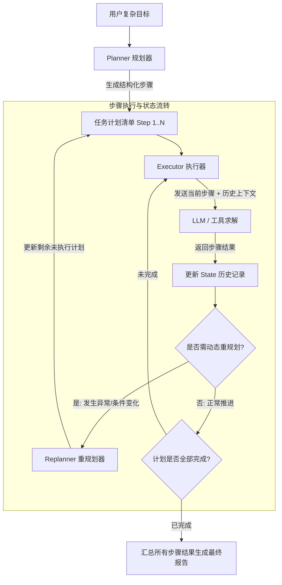
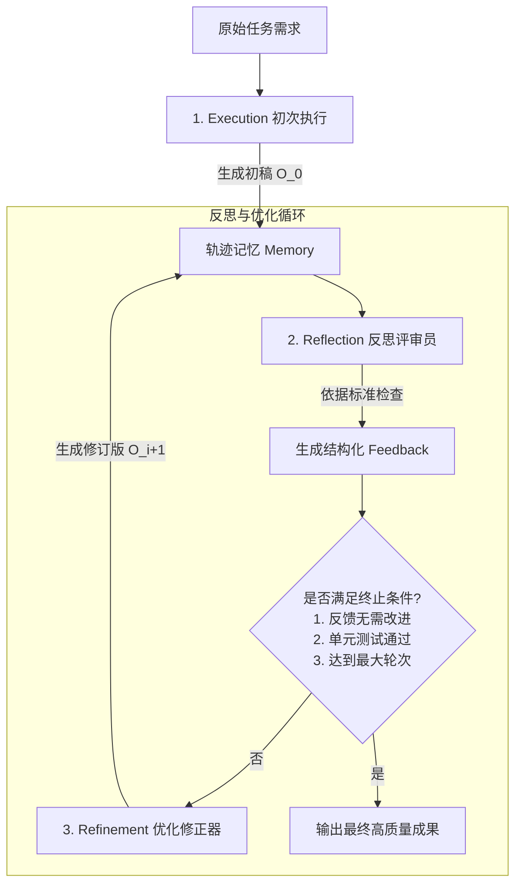
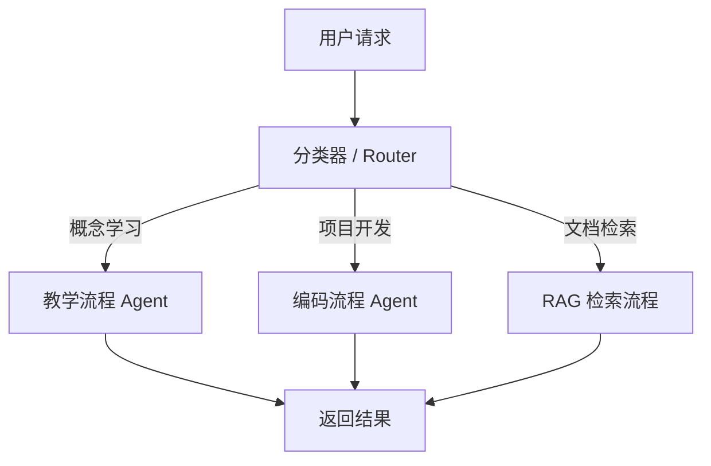
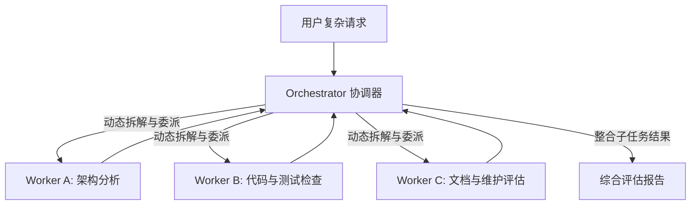
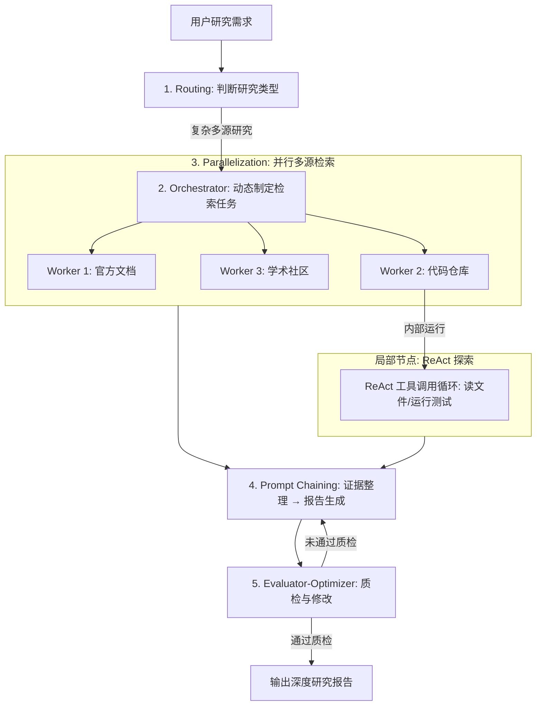

# 1 经典决策范式（Decision-Making Paradigms）

## 1.1 ReAct 范式：推理与行动的交织循环

### 1.1.1 核心原理与闭环机制
ReAct（Reasoning and Acting）范式强调“边想边做、动态调整”。它将大语言模型的推理（Reasoning）与对外部环境的行动（Acting）紧密交织在一起，运行在持续的 Thought-Action-Observation 闭环中：
* **Thought（思考）**：智能体的内心独白。分析当前目标与上下文状态，评估已知信息，决定下一步是否需要调用工具以及选择何种工具。
* **Action（行动）**：智能体发出的具体指令，通常为结构化的工具调用请求。
* **Observation（观察）**：宿主环境执行 Action 后返回的真实客观反馈（如 API 返回数据、数据库查询结果、程序执行日志等）。
* **Final Answer（最终答案）**：当 Thought 判断已有 Observation 足够解答任务时，停止工具调用并输出结论。

**ReAct 与 Agent Loop 的关系辨析**：
Agent Loop 是底层的执行控制循环，负责驱动“接收输入-模型推理-工具调用-结果接收”的物理流程；而 ReAct 则是在该循环之上的一种决策策略，决定了模型如何交替组织内心思考与外部动作。

### 1.1.2 系统提示词契约与解析机制
ReAct 的稳定流转高度依赖系统提示词（System Prompt）对模型输出格式的强约束。一个标准的 ReAct 提示词结构包含以下核心模块：
* **角色定义与流转规约**：明确要求模型严格按照 Thought:、Action:、Observation: 的规范顺序输出。
* **可用工具列表（Tools Description）**：向模型提供工具名称、功能说明及入参格式规范，这是模型决定调用何种工具的主要依据。
* **Few-Shot 格式示例**：提供标准的 Thought/Action 多轮交替范例，指导模型正确使用换行与分隔符。
* **历史轨迹（History）**：将上一轮的 Action 和 Observation 追加到上下文，使模型能感知外部反馈。

如果模型的输出偏离了预定义契约（如忘记输出 Action 标签或参数格式错误），宿主的解析器（Parser）将无法提取有效指令，导致调用中断。

### 1.1.3 核心优势与固有局限
* **核心优势**：
  * **高透明度与可解释性**：Thought 链清晰展示了智能体的推理脉络，便于开发者排查失败节点。
  * **动态环境适应与纠错**：“走一步看一步”，上一步工具执行失败或结果不理想时，可在下一步自动修正搜索词或切换工具。
  * **拓展 LLM 能力边界**：将推理与 API/搜索引擎无缝对接，解决模型时效性差与计算不准问题。
* **固有局限**：
  * **强依赖底层模型推理力**：若模型指令遵循能力不足，容易产生格式错乱，导致宿主解析中断。
  * **延迟与 Token 成本累加**：串行多轮调用使端到端响应耗时较长，历史轨迹膨胀迅速。
  * **缺乏全局长远规划**：步进式决策容易导致“眼前的局部最优”，在长链条复杂任务中可能陷入原地打转的死循环。

### 1.1.4 典型应用场景与实际执行过程
以“查找公司知识库中关于 MCP 的资料，并总结 MCP 与 Tool Calling 的区别”为例，ReAct 范式的动态执行轨迹如下表所示：

| 执行步骤 | 当前判断与行动（Thought & Action） | 获得的结果（Observation） |
| ------ | ------ | ------ |
| 步骤 1 | 决定先检索 MCP 的基本定义 | 找到 MCP 架构文档 |
| 步骤 2 | 发现还缺少 Tool Calling 的信息，决定继续检索 | 找到工具调用相关文档 |
| 步骤 3 | 发现需要进行概念比较，决定检索两者的关系 | 获得进一步的证据支持 |
| 步骤 4 | 判断当前资料足以支持结论，输出 Final Answer | 总结生成最终对比报告 |

**典型应用场景**：
* **动态信息检索与事实核验**：查询最新时事新闻、股市行情、天气等路径无法预先固定的任务。
* **探索性排错与 Debug**：按“读取日志 -> 查找异常 -> 测试命令 -> 验证结果”进行一步步探索。
* **轻量级 API 调度与交互**：基于即时返回信息决定后续接口调用的流程。

## 1.2 Plan-and-Solve 范式：先规划，后执行

### 1.2.1 核心原理与解耦思想
Plan-and-Solve 范式旨在解决思维链（CoT）与 ReAct 在处理长流程复杂任务时容易“偏离主线”或“遗漏步骤”的问题。该范式将智能体运行明确解耦为两个阶段：
* **规划阶段（Planning Phase）**：接收任务后不立即调用工具，而是由 Planner 模块对目标进行宏观拆解，生成结构化、有序的子任务计划列表（Plan）。
* **执行阶段（Solving Phase）**：Executor 模块严格按照计划步骤逐一执行，每一步求解时将原始目标、完整计划、已完成步骤及结果作为上下文，保障信息传递顺畅与目标一致。

### 1.2.2 架构组件与动态重规划
* **Planner（规划器）**：专注于目标拆解，生成结构化 JSON 列表或任务链。
* **Executor（执行器）**：专注于具体步骤的求解，可调用 LLM 或工具完成单个子任务，并将结果更新至共享状态（State）。
* **Replanner（动态重规划器）**：在高级实现中，每完成一步均评估 Observation。若原计划不可行或条件改变，动态修正后续未执行计划。

### 1.2.3 工业级工程保障
* **计划校验（Plan Verification）**：执行前检查步骤间是否存在逻辑断层或无法执行的指令。
* **状态管理（State Management）**：明确标记每个步骤的状态（待执行、执行中、已完成、已失败）。
* **动态重规划（Dynamic Replanning）**：某步骤失败时，Replanner 捕获失败日志，保留已完成步骤，对剩余计划重新路由。
* **副作用控制（Side-Effect Control）**：对删除数据、付费调用等有副作用的动作建立人机协作（Human-in-the-Loop）审批节点。

### 1.2.4 核心优势与固有局限
* **核心优势**：结构清晰，目标一致性极强，全局掌控力好，不易在长流程中偏离轨道，方便跟踪进度。
* **固有局限**：静态模式较为僵化，若缺少 Replanner 补强，初始计划不合理将导致后续连锁崩溃。

### 1.2.5 典型应用场景与计划拆解示例
以“研究 MCP 与 Tool Calling 的区别”为例，Plan-and-Solve 范式会先生成高层次任务分解：
1. 检索 MCP 的定义与基本架构。
2. 检索 Tool Calling 的调用机制。
3. 比较二者的职责、运行位置和适用场景。
4. 根据检索结果整理对比表。
5. 检查结论是否有证据支持并输出。

**典型应用场景**：
* **结构化分析与多步计算**：复杂数学应用题、逻辑推理。
* **长篇报告与文档生成**：需求分析 -> 数据收集 -> 架构对比 -> 结论撰写。
* **预定义 SOP 流程自动化**：标准打包发布流程、定期运维检查。

## 1.3 Reflection 范式：自我反思与迭代优化

### 1.3.1 核心原理与反馈回路
Reflection 范式（以 Reflexion 框架为代表）的核心思想是引入事后（Post-hoc）自我校正闭环。它模仿人类“写初稿 -> 审阅校对 -> 指出缺陷 -> 修改润色”的习惯，将一次性生成升级为持续优化的迭代过程：
* **Execution（执行）**：智能体尝试完成任务，生成初始解决方案或初稿（$O_0$）。
* **Reflection（反思/评估）**：独立的“评审员（Critic）”角色对上一轮输出进行审查（事实错误、逻辑漏洞、边界遗漏等），生成结构化反馈（Feedback）。
* **Refinement（优化/修正）**：优化器（Refiner）结合原始任务、上一轮尝试及 Feedback，生成修改后的新版本（$O_{i+1}$）。

### 1.3.2 轨迹记忆与流程图
为了避免无休止乱改，系统维持一个**短期轨迹记忆模块（Memory）**，顺序记录：初稿 -> 反馈 -> 优化 -> 反馈...，将完整轨迹注入 Prompt，引导阶梯式质量提升。

### 1.3.3 评估标准与终止条件
* **评估维度**：
  * **概念准确性**：是否存在概念混淆（如混淆 MCP Client 与 Server）。
  * **内容完整性**：关键要素是否覆盖全面。
  * **证据支持**：关键结论是否有客观数据或文档证据支持。
  * **结构与规范**：是否符合格式要求、代码规范或类型校验。
* **终止条件**：
  * 评审员输出“无需改进”信号。
  * 程序化断言/单元测试 100% 通过。
  * 达到最大轮次限制（如 Max Iterations = 3），防止无限循环。

### 1.3.4 关键辨析：Reflection 与异常处理/重试的区别
在 Agent 开发中，必须严格区分“Reflection 机制”与“底层的异常处理与重试”：

| 机制维度 | 异常处理与重试（Exception Handling & Retry） | Reflection 反思机制（Self-Reflection） |
| ------ | ------ | ------ |
| **触发条件** | 工具调用失败、网络超时、参数格式解析报错 | 结果已生成，但存在质量缺陷、逻辑漏洞或未通过评估 |
| **主要作用** | 确保程序物理执行不崩溃，恢复控制流 | 提升产物质量，优化推理逻辑与内容表达 |
| **反馈依据** | 系统报错日志、HTTP 状态码、Traceback 堆栈 | 明确的评估标准、单元测试结果、评审员语言反馈 |

**工程落地关键原则**：Reflection 应当与客观结果校验相结合。单纯依靠模型自问“你做得好吗”容易产生盲点；只有结合外部单元测试、编译器反馈或客观证据校验，反思机制才能真正发挥作用。

### 1.3.5 核心优势、工程代价与典型场景
* **核心优势**：输出质量大幅跃迁，具备内部自我纠错能力，减少人工干预。
* **工程代价**：调用成本与延时倍增；同模型自我评价可能存在认知盲点。
* **典型场景**：高质量代码生成与算法重构、学术论文与技术文档审阅润色、高风险决策的自我校验。

## 1.4 三大决策范式多维度对比与组合选型

### 1.4.1 多维度对比矩阵

| 对比维度 | ReAct 范式 | Plan-and-Solve 范式 | Reflection 范式 |
| ------ | ------ | ------ | ------ |
| **核心思路** | 推理与行动交织（边想边做） | 先全局拆解计划，再逐步求解 | 生成初稿后，事后评估与修正 |
| **主要机制** | 决策 → 行动 → 观察 → 再决策 | 规划 → 执行 → 汇总 | 执行 → 评估 → 改进 |
| **决策时机** | 实时动态决策，依赖即时反馈 | 任务启动前预规划（结合运行中重规划） | 阶段性产物生成之后进行二次评估 |
| **核心优势** | 透明度高，动态纠错力强，适合探索 | 结构清晰，目标一致性强，不易偏离 | 显著提升最终产物质量，纠正高层逻辑缺陷 |
| **核心风险** | 无全局规划，易陷入死循环或局部最优 | 初始计划若不合理易引发连锁错误 | 成本与延时倍增，同一模型自评可能存在死角 |
| **工具依赖** | 高度依赖外部工具（API、搜索） | 中/高（步骤中可嵌入工具调用） | 不一定依赖工具（亦可纯文本/代码审查） |
| **典型场景** | 未知问题排查、实时信息查询、API 调度 | 复杂计算、长篇报告撰写、结构化分析 | 代码生成与优化、文档审查、高质量创作 |

### 1.4.2 决策范式选型指南
在实际开发中，应从任务的主要不确定性特征出发选择范式：
* **需要根据每一步获得的信息，动态决定下一步行动？** 优先选择 **ReAct**。
* **能够提前拆分任务，并明确各步骤的顺序与依赖？** 优先选择 **Plan-and-Solve**，必要时保留动态重规划机制。
* **初始结果可能存在错误、遗漏或质量不足，需要评估后改进？** 优先选择 **Reflection**，并配合客观测试标准。

### 1.4.3 范式的顺次组合应用模式
在复杂任务（如研究陌生技术并输出深度报告）中，三大范式可顺次组合协作：
1. **Plan-and-Solve（先规划）**：将任务拆分为概念检索、原理分析、方案比较、证据核对和报告撰写等子任务。
2. **ReAct（动态执行）**：在检索与分析子任务中，根据获得的资料动态判断是否改写查询、补充搜索或核实矛盾证据。
3. **Reflection（评估改进）**：报告初稿生成后，由 Critic 角色检查概念准确性、证据支持度与结构完整性，发现问题后修改。
4. **停止控制（确定终止）**：达到质量标准时交付，超过执行预算或无法获得可靠证据时停止并说明限制。

# 2 五大核心工作流模式（Workflow Patterns）

## 2.1 Prompt Chaining（提示链 / 顺序工作流）

### 2.1.1 核心思想与执行机制
将一个复杂任务拆解为具有明确依赖关系的多个顺序步骤，前一步的输出直接作为后一步的输入，形成固定的流水线。

### 2.1.2 阶段流转示例与特点
* **Step 1：提取资料**（LLM 识别关键知识点）
* **Step 2：检索证据**（RAG 返回相关片段与来源）
* **Step 3：生成答案**（基于证据形成初始回答）
* **Step 4：校验引用**（检查结论是否被证据支持）

**特点与适用条件**：
* **优点**：每个阶段职责清晰，便于分别优化 Prompt、设置检查点与单独测试。
* **缺点**：多阶段增加端到端延迟与 Token 开销；前一步骤的错误容易向下传递放大。
* **适用条件**：任务可清晰拆解且后续步骤严格依赖前步输出（如文档生成、固定步骤审核流、结构化信息提取）。

## 2.2 Routing（路由 / 分流）

### 2.2.1 核心思想与机制
先判断输入请求属于什么类型，再将其分发给最合适的专有处理分支。路由器可以由预定义规则、分类模型或 LLM 动态判断实现。

### 2.2.2 特点与适用场景
* **优点**：有效分离不同任务的 Prompt、工具列表与处理逻辑，降低单个 Prompt 的复杂度和干扰。
* **缺点**：路由判断错误将导致任务被送入不合适的流程。
* **适用条件**：输入存在明确类别划分，且不同类别确实需要完全不同的处理逻辑与工具栈。

## 2.3 Parallelization（并行化）

### 2.3.1 核心思想与两大形式
对于彼此独立、可同时完成的子任务，采用并行并发执行，最后进行结果汇总。
* **Sectioning（任务拆分）**：将总任务拆分为不同子任务（如并发检索官方文档、GitHub 仓库与技术文章），由多个模型调用同时处理。
* **Voting（多次生成/投票）**：对同一个问题运行多次独立尝试，对结果进行比较、投票或聚合。

### 2.3.2 特点与适用场景
* **优点**：大幅缩短总执行耗时，实现关注点分离。
* **缺点**：增加并发 Token 开销，需要设计结果合并与冲突解决逻辑；多个调用可能犯相同错误。
* **适用条件**：子任务之间无依赖关系。若子任务间存在前后依赖，则不能盲目并行。

## 2.4 Orchestrator-Workers（协调器—工作者）

### 2.4.1 核心思想与机制
由一个中央协调器（Orchestrator）根据具体任务动态拆解子任务，再委派给多个工作者（Workers）并发执行，最后由协调器汇总整合结果。

### 2.4.2 与普通 Parallelization 的根本区别
* **普通 Parallelization**：由开发者在代码中**预先硬编码**固定的并行分支。
* **Orchestrator-Workers**：协调器**根据具体的输入内容动态决定**子任务的数量与具体种类。

**特点与适用场景**：
* **优点**：能够应对极高不确定性的复杂任务（如分析不同项目的代码漏洞）。
* **缺点**：协调逻辑、结果整合及异常处理非常复杂，要求子任务间界限清晰。

## 2.5 Evaluator-Optimizer（评估器—优化器）

### 2.5.1 核心思想与机制
由生成器（Generator）产生初始结果，评估器（Evaluator）依据明确标准检查并输出反馈，生成器根据反馈修改，直至达到验收要求或触发终止条件。

### 2.5.2 特点与适用场景
* **优点**：适合有清晰评估标准且迭代能显著提升质量的任务（如 RAG 评测报告生成、符合特定结构的格式化输出）。
* **缺点**：增加调用开销与延时；若评估标准不够可靠，可能导致无意义的循环修改。

## 2.6 五大 Workflow Patterns 选型矩阵

| 任务特征 | 优先选择的工作流模式 | 核心理由 |
| ------ | ------ | ------ |
| 步骤明确，后续步骤依赖前步输出 | **Prompt Chaining** | 链式传递顺畅，各步骤关注点分离 |
| 输入有明显类型，不同类别需不同逻辑 | **Routing** | 隔离 Prompt 与工具，提高专业化程度 |
| 子任务互相独立，希望能缩短耗时 | **Parallelization** | 并行并发处理，提升响应速度 |
| 子任务数量与内容无法预先确定，需动态拆解 | **Orchestrator-Workers** | 灵活适应复杂场景，动态分派任务 |
| 拥有清晰的评估标准，迭代能提升质量 | **Evaluator-Optimizer** | 闭环质检，确保产物达到硬性标准 |

# 3 决策范式与工作流模式的映射与工业级混合编排

## 3.1 经典决策范式与 Workflow Patterns 的关系

经典 Agent 范式描述的是**单点或局部的决策逻辑**（智能体如何思考与行动），而 Workflow Patterns 描述的是**多个步骤在宏观上如何组织与调度**。二者处于不同层次，可以灵活结合：

| 经典决策范式             | 常见的 Workflow 组织模式                 | 关系与融合方式            |
| ------------------ | --------------------------------- | ------------------ |
| **ReAct**          | Agent Loop、条件分支与循环                | 专注于局部步骤中的工具探索与动态排错 |
| **Plan-and-Solve** | Prompt Chaining 或 Orchestrator 流程 | 负责宏观路线规划，将规划拆解为步骤链 |
| **Reflection**     | Evaluator-Optimizer               | 通过评估与反馈推进结果精炼      |

## 3.2 工业级多模式混合编排全景架构

在复杂的生产级应用中（如多源深度研究、复杂 Bug 自动修复），通常将多种模式组合编排使用：

## 3.3 混合编排的三大设计原则

* **控制流定主干**：使用概率极低、确定性高的 Workflow 模式（Routing, Prompt Chaining）搭建主框架与安全外壳，保障系统的可预测性。
* **Agent 算局部引擎**：在需要自由度、复杂排错或工具调用的局部节点（Worker / Step）插入 ReAct 或 Reflection 机制，发挥 LLM 的自主灵活性。
* **明确边界与降级**：每个子模块之间建立明确的输入输出契约，并设定最大重试轮次与降级逻辑，防止局部失败引发整体系统雪崩。
