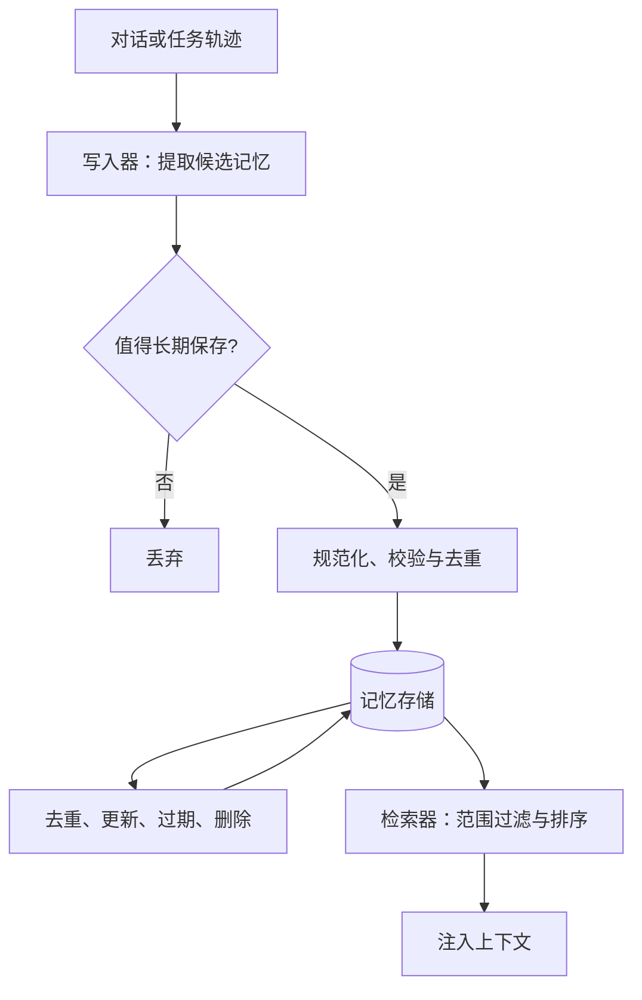
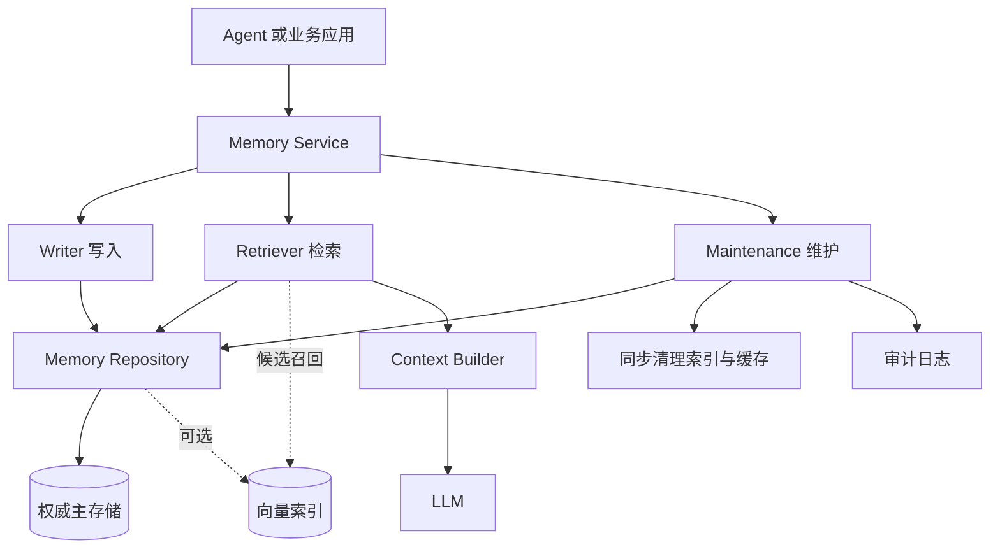

## 1 记忆基础

### 1.1 记忆的定义

Memory（记忆）不是保存全部聊天记录，而是在过滤、评估和提炼后，保存未来仍可能复用的信息。

* **核心价值**：实现跨会话、跨任务的个性化适配、经验积累和能力演进。
* **作用范围**：跨越单个 Session（会话）或任务线程。
* **关键边界**：记忆被保存，不代表本轮模型一定能看到；只有经过筛选并进入 Context（上下文）的内容才会影响当前推理。

### 1.2 持久化与记忆

持久化（Persistence）是数据保存手段，Memory（记忆）是数据管理语义。数据库里存在数据，不代表它就是 Agent 的长期记忆。

以 LangGraph 为例，Checkpointer（检查点机制）负责恢复特定线程内的运行状态，Store（存储库）负责跨线程、按 Namespace（命名空间）保存和检索长期信息。两者即使都使用 PostgreSQL，语义和访问方式仍然不同。

## 2 记忆类型与存储结构

### 2.1 短期记忆与长期记忆

短期与长期的核心分界不是物理保存时间，而是作用范围。

| 对比维度 | Short-term Memory（短期记忆） | Long-term Memory（长期记忆） |
| --- | --- | --- |
| 主要作用 | 维持当前会话或任务线程的执行连贯性 | 为未来会话和跨任务交互提供可复用经验 |
| 解决问题 | 记住刚才正在做什么 | 积累偏好、稳定事实和历史经验 |
| 典型内容 | 近期对话、工具 Observation（观察结果）、待办步骤 | 用户偏好、领域事实、踩坑经验 |
| 作用范围 | 单个线程或会话 | 跨线程、跨会话 |
| 持久化组件 | Checkpointer、线程状态数据库 | Memory Store、向量数据库、关系数据库 |
| 生效方式 | 直接恢复当前线程轨迹 | 经过选择性检索后注入 Context |

### 2.2 长期记忆的三种类型

**（1）语义记忆（Semantic Memory / 事实记忆）**

保存关于世界的稳定事实、用户偏好和概念关系，例如“用户偏好 Python”“项目使用 PostgreSQL”。

**（2）情景记忆（Episodic Memory / 事件记忆）**

保存特定时间发生的任务经历、错误和解决方案，例如“某次升级失败的原因是依赖版本冲突”。

**（3）程序性记忆（Procedural Memory / 操作规则）**

保存完成任务的方法和业务规则，可以通过 System Prompt（系统提示词）、Agent Skills、工具实现或 Few-Shot（少样本）示例固化。

### 2.3 Profile（画像模式）与 Collection（集合模式）

**Profile（画像模式）**：把某个用户、项目或环境的信息集中在结构化卡片或 JSON/KV 对象中，例如技术栈、语言偏好和项目角色。它便于整体读取和维护，但字段过多后容易出现更新冲突。

**Collection（集合模式）**：把每条事实或偏好保存为独立记录，粒度细，便于追加、更新、过期和删除，也适合向量检索；缺点是信息容易碎片化，需要去重、关联和冲突治理。

初始阶段可用 Profile 保存硬性偏好；系统复杂后可组合使用：Profile 保存稳定约束，Collection 保存动态事实和事件经验。

## 3 记忆工程目标与生命周期

### 3.1 核心工程问题

* **信息筛选**：判断哪些内容具有长期复用价值。
* **防止污染**：阻止错误推断、未经验证的信息和恶意内容进入长期存储。
* **准确召回**：在新任务中找出权限正确、语义相关且仍然有效的记忆。
* **冲突消解**：处理新旧信息矛盾，决定更新、覆盖、版本化或共存。
* **生命周期治理**：控制重复、过期、删除、存储膨胀和隐私风险。

### 3.2 六项核心操作

* **Write（写入）**：从交互中提取候选信息，评估后规范化保存。
* **Retrieve（检索）**：按当前任务查找相关、有效且有权使用的记忆。
* **Update（更新）**：在事实变化或纠错时维护记录正确性。
* **Deduplicate（去重）**：识别并合并重复记忆，减少冗余。
* **Expire（过期）**：为临时记忆设置 TTL（生存时间），到期后失效或清理。
* **Delete（删除）**：响应用户指令或隐私政策，删除主存储、索引和缓存中的记录。

### 3.3 工程组件与职责

* **Memory Service（记忆服务）**：统一提供记忆业务接口和生命周期逻辑。
* **Writer（写入器）**：筛选、提炼、规范化长期信息，并识别潜在冲突。
* **Store / Repository（存储层/仓储）**：保存记忆正文、作用域、来源、版本和生命周期状态。
* **Retriever（检索器）**：按权限、相关性和时效召回有效记忆。
* **Maintenance / Governance（维护与治理）**：处理更新、版本化、去重、过期和物理清理。
* **Vector Index（向量索引）**：提供语义候选召回，不是权威数据源。
* **Context Builder（上下文构建器）**：过滤、排序并按 Token（词元）预算组装 Prompt（提示词）。
* **PostgreSQL / 主存储**：保存权威正文、版本、来源和生命周期字段。

各组件的详细部署与协同关系见第 6 节。

## 4 记忆写入机制

### 4.1 写入前的五项判断

* **复用价值**：未来任务或新会话是否可能再次需要。
* **可靠性**：信息来自用户明确确认、系统结果还是模型推断。
* **稳定性**：它是长期约束、稳定事实，还是容易失效的临时状态。
* **必要性与隐私**：遵循数据最小化原则，禁止保存密钥、凭据和敏感隐私。
* **可维护性**：记录应具备唯一标识、作用域和来源，能够被精确更新或删除。

### 4.2 规范化数据结构

记忆记录至少应包含以下字段：

* `memory_id`：唯一标识，用于更新、版本化和精准删除。
* `scope`：用户、租户和项目作用域，用于权限隔离。
* `type`：事实、偏好、事件或操作规则等类型。
* `content`：去除口语和冗余后的规范正文。
* `source`：用户陈述、系统结果或模型推断等来源。
* `confidence`：来源和提取结果的置信度。
* `status`：`active`、`superseded`、`expired`、`deleted` 等状态。
* `version`：用于版本链表和并发更新。
* `created_at`、`updated_at`、`last_accessed_at`：创建、更新和最近访问时间。
* `expires_at`、`valid_until`：保留期限和事实有效期限。
* `superseded_by_id`：被哪条新记录取代。

### 4.3 六步写入流程

1. **Capture（捕获）**：从明确指令、任务结果或反馈中提取候选信息。
2. **Evaluate（评估）**：按复用价值、可靠性、稳定性、隐私和可维护性判断。
3. **Normalize（规范化）**：压缩成清晰断言，补齐作用域、来源和类型。
4. **Match（匹配）**：查找同作用域的相同、相似或冲突记录。
5. **Decide（决策）**：选择新建、更新、合并、跳过、版本化或标记争议。
6. **Persist（持久化）**：在事务中写入主存储，并同步维护索引。

### 4.4 写入时机

* **Hot Path（主路径实时写入）**：在响应用户前同步写入，时效性高，但增加当前请求延迟。
* **Background（后台异步写入）**：先把轨迹放入队列，由 Worker（工作进程）异步处理，主流程延迟低，但记忆更新存在滞后。

## 5 记忆检索机制

### 5.1 三层判断

* **范围判断**：先按用户、租户和项目做硬性权限隔离。
* **相关性判断**：从安全范围内查找语义或术语相关的候选记忆。
* **上下文判断**：再按时效、置信度和 Token（词元）预算决定哪些进入 Context。

### 5.2 检索前的强制过滤

权限必须在存储层或检索层完成，不能先返回全库相似结果再依赖 Prompt 让模型自行过滤。

过滤维度包括用户范围、项目范围、记录状态、记忆类型、有效期和访问权限。已过期、已取代、已删除或无权限的记录不得进入候选集。

### 5.3 检索算法

**结构化查询**适合按 `memory_id`、用户 ID 或明确字段精确查找，结果稳定，但无法理解模糊自然语言。

**关键词检索（BM25）**适合术语、API 名称和专有名词，但对同义词和语义改写能力较弱。

**向量语义检索**适合查找表达不同但含义接近的偏好和经验，但可能召回“字面相似、实际无关”的内容。

**混合检索（Hybrid Search）**组合关键词与向量召回，并通过 Reranker（重排器）排序，适合生产环境，但实现和延迟成本更高。

### 5.4 上下文组装

检索结果不能以原始数据库 JSON 直接塞给模型。Context Builder（上下文构建器）应提取规范正文、来源、时间和适用条件，再放入明确的记忆分区。

注入数量要受 Token 预算和 Top-K 限制，并按综合得分截断。系统指令和当前任务输入应优先保留。

## 6 记忆系统工程架构

### 6.1 架构原则

长期记忆、会话历史、任务 State 和 RAG 知识库的查询方式、生命周期与权限模型不同，应逻辑解耦。

PostgreSQL 等权威主存储保存规范记录，向量索引只负责辅助召回。索引丢失或更新失败时，系统应能从主存储重建，而不是导致记忆数据丢失。

![[记忆系统开发架构图.png]]

### 6.2 独立 Memory Service

复杂系统可将记忆业务封装为独立 Memory Service（记忆服务），统一提供写入、检索、更新、过期和删除接口。

### 6.3 去重流程

![[记忆去重流程.png]]

去重应先使用确定性规则和结构化字段比对，再使用语义相似度判断；无法确认完全等价时，不应自动合并。

## 7 工程底线

* 禁止把全部聊天记录无条件写入长期记忆。
* 短期与长期的划分看作用范围和复用方式，不看物理存储时长。
* 长期记忆必须具备写入、检索、更新、去重、过期和删除闭环。
* 权限过滤必须在检索层或数据层完成，不能依赖 Prompt 自我约束。
* RAG 知识库与长期记忆应保持存储、检索入口和权限模型隔离。
* 删除必须覆盖主存储、索引、缓存和后台回流路径。
* 不确定是否语义等价时，不应自动合并。
* 记忆写入成功率、检索命中率、冲突率和删除完整性应纳入评测与可观测性体系，参见 [[_自动化评测]] 和 [[_LLMOps与可观测性运维]]。
