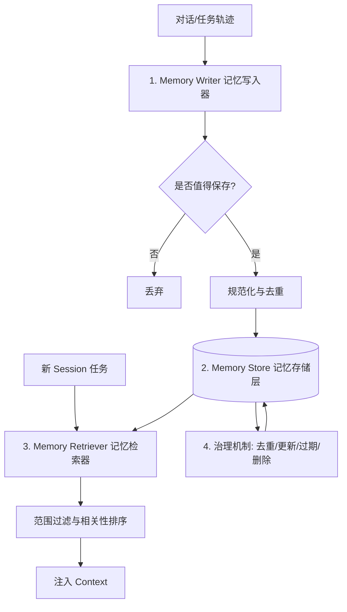
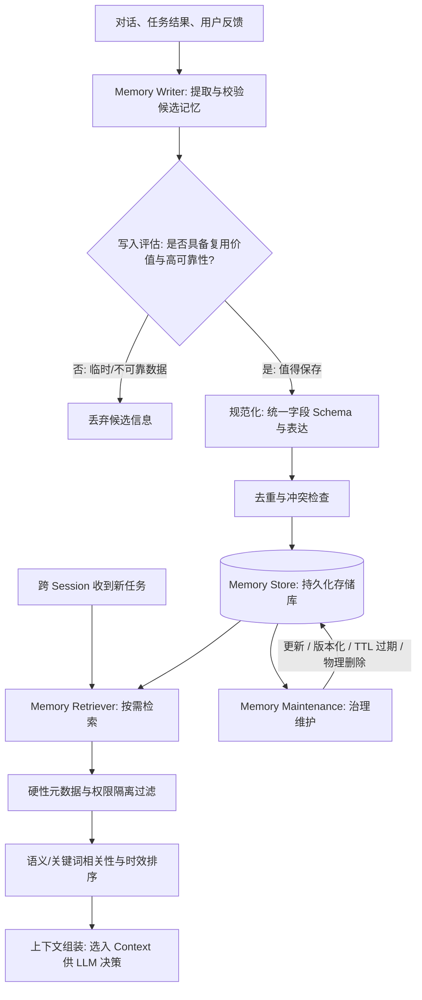
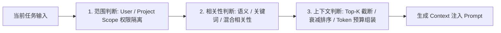
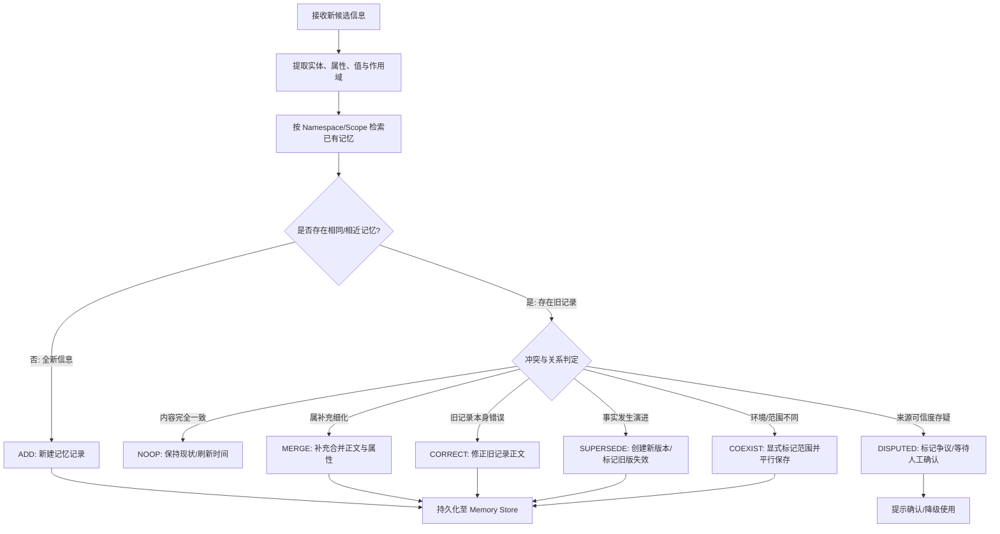
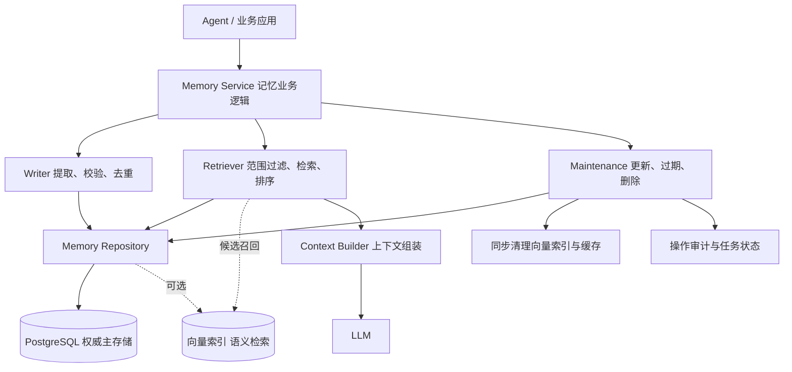
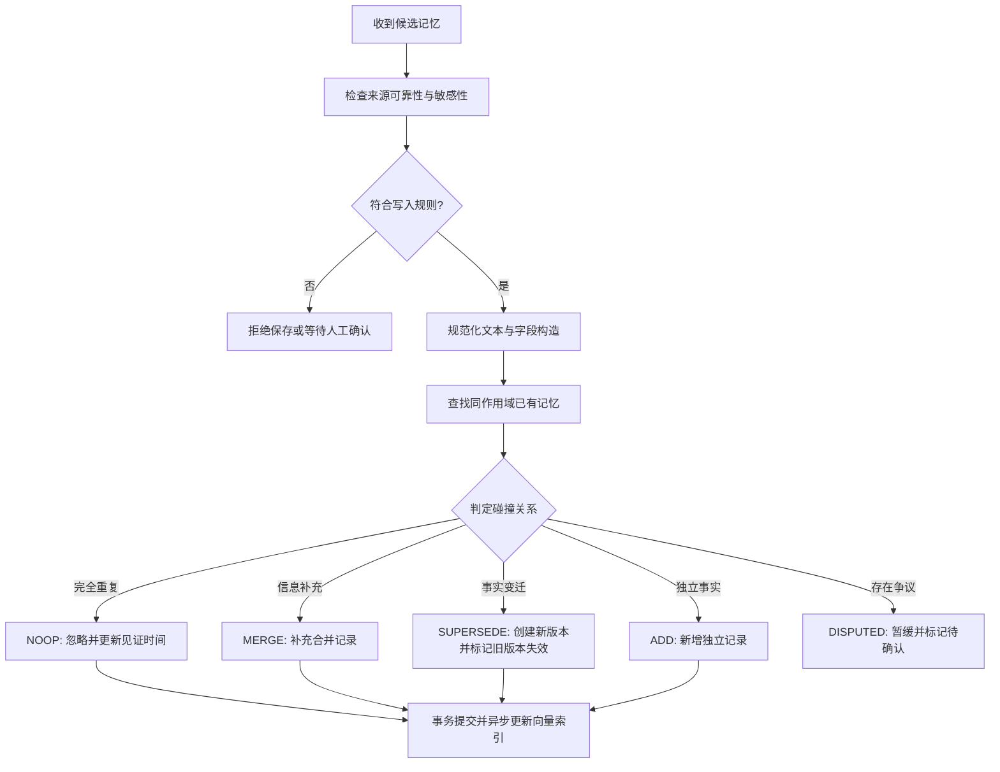
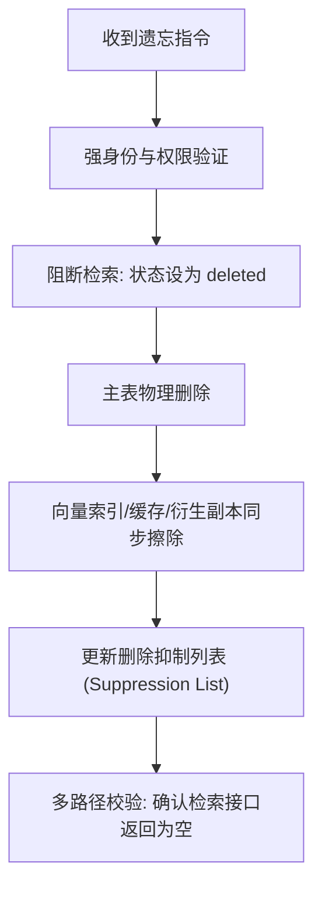

## 1 记忆系统的基本概念与四大要素

#### 1.1.1 State（状态）

State 是 Agent 在执行特定任务过程中需要实时维护与更新的结构化数据卡片。

* **核心价值**：维持任务执行的连续性与断点恢复能力。它明确回答当前目标是什么、已完成哪些步骤、下一步计划是什么，以及上一阶段工具调用的结果。
* **运行机制**：State 是工作流或智能体节点之间共享的运行数据卡片。在支持长周期运行的框架（如 LangGraph）中，State 的快照由 Checkpointer 自动保存为检查点（Checkpoint），支持系统崩溃后的状态恢复、暂停挂起与人机协作干预（Human-in-the-Loop）。

State 典型包含字段结构：

| 类别 | 典型字段 | 作用说明 |
| ------ | ------ | ------ |
| 任务信息 | 任务 ID、目标、执行状态 | 标识当前任务的唯一性与总路线 |
| 执行进度 | 当前步骤、已完成步骤、已调用次数 | 跟踪任务推进流水线 |
| 中间结果 | 检索结果引用、分析数据、生成的文件路径 | 传递各节点产生的阶段性产物 |
| 控制信息 | 是否等待审批、重试标记、停止条件 | 控制流程分支与安全边界 |
| 运行消息 | 涉及的用户消息、工具调用请求与 Observation | 维护当前单任务内的局部消息轨迹 |
#### 1.1.2 Session（会话）

Session 是应用层用于区分和管理用户交互轨迹的逻辑单元。

* **核心价值**：将会话分组并与用户身份绑定。例如，同一个用户可以在 Session A 中学习 Agent 架构，在 Session B 中开发 RAG 系统，互不干扰。
* **运行机制**：Session 自身通常表现为一个唯一的标识符（如 session_id 或 thread_id）。Session 负责组织交互通道与消息历史的路由，但 Session 本身并非物理存储容器，消息与状态的物理保存依赖底层的存储服务。

#### 1.1.3 Context（上下文）

Context 是在触发某一次 LLM 推理采样时，真正注入大模型输入窗口中的全量 Tokens 集合。

* **核心价值**：向模型提供当前决策所需的最小必要信息，避免信息过载与噪声干扰。
* **运行机制**：即使系统数据库中保存了海量的历史消息和长期记忆，只有被 Context Builder 筛选、提取并成功拼接到 Prompt 中的信息，才属于当前轮次的 Context。未被检索或注入 Context 的记忆，模型在当前轮次完全无法感知。

#### 1.1.4 Memory（记忆）

Memory 的本质不是无差别记录所有发生的对话，而是在过滤、评估与提炼后，保存具有未来复用价值的信息。

* **核心价值**：实现跨会话、跨任务的个性化适配、经验积累与能力演进。
* **运行机制**：Memory 的作用域超越了单个 Session 或线程。当用户在全新的 Session 中发起任务时，系统从 Memory 库中拉取关联的偏好或历史事实注入 Context，使 Agent 具备长期记忆与个性化表达能力。

| 概念名称        | 中文含义 | 核心回答问题           | 典型包含内容                          | 作用范围与持久化机制                         |
| ----------- | ---- | ---------------- | ------------------------------- | ---------------------------------- |
| **State**   | 任务状态 | 当前任务进行到哪一步？      | 当前步骤、待办事项、中间结果、错误日志、检查点         | 单个任务线程（Thread）；通过 Checkpointer 持久化 |
| **Session** | 会话   | 哪些交互属于同一次对话？     | 会话 ID、线程 ID (thread_id)、关联的用户属性 | 应用层交互分组；通过会话服务或数据库维护               |
| **Context** | 上下文  | 这一轮 LLM 实际看到了什么？ | 系统指令、当前输入、高价值历史、工具结果、检索片段       | 单次 LLM API 调用；随推理循环动态构建与销毁         |
| **Memory**  | 长期记忆 | 哪些信息值得保存供未来复用？   | 用户偏好、稳定事实、历史经验、项目背景卡片           | 跨会话/跨线程；通过独立的 Memory Store/数据库保存   |
#### 1.3.3 持久化（Persistence）与记忆（Memory）的区别

数据库存储的数据不等于 Memory。持久化是技术实现手段，Memory 是数据管理语义。

在 LangGraph 架构中，Checkpointer（检查点）负责特定线程（Thread）内运行状态的恢复，而 Store（存储库）负责跨线程、按 Namespace 存储和检索长期信息。两者在物理存储上虽然都可以是 PostgreSQL，但语义和使用方式完全不同。

## 2 短期记忆与长期记忆的划分与架构选型

| 对比维度      | Short-term Memory（短期记忆）      | Long-term Memory（长期记忆）               |
| --------- | ---------------------------- | ------------------------------------ |
| **主要作用**  | 维持当前会话或特定任务线程的执行连贯性          | 为未来的新会话与跨任务交互提供可复用经验                 |
| **解决问题**  | 解决 Agent“记得刚才在做什么”的问题。       | 解决 Agent“积累用户偏好与历史经验”的问题。            |
| **典型内容**  | 近期对话历史、工具执行 Observation、待办步骤 | 用户个人偏好、领域稳定事实、历史踩坑经验                 |
| **作用范围**  | 单个线程（Thread）或单个会话（Session）   | 跨线程（Cross-thread）、跨会话（Cross-session） |
| **持久化组件** | Checkpointer / 线程状态数据库       | Memory Store / 向量数据库 / 关系数据库         |
| **生效方式**  | 作为当前线程轨迹直接载入或恢复              | 必须经过选择性检索后方可注入 Context               |

### 2.2 长期记忆的三种经典类型

#### 2.2.1 Semantic Memory（语义记忆 / 事实记忆）

保存关于世界的稳定客观事实、用户偏好或概念间的关系。
#### 2.2.2 Episodic Memory（情景记忆 / 事件记忆）

保存过去特定时间发生的具体事件、任务执行经历或排错经验。

#### 2.2.3 Procedural Memory（程序性记忆 / 操作规则）

保存完成特定任务的方法、SOP 步骤、业务规则或操作模式。通常以 System Prompt、Agent Skills、硬编码工具以及 Few-Shot 范例的形式固化在系统中。

### 2.3 长期记忆的存储结构选型：Profile 与 Collection

工程落地中，长期记忆的存储组织形式主要分为 Profile（用户画像模式）与 Collection（独立记忆集合模式）。

#### 2.3.1 Profile 模式（集中维护画像/卡片）

将关于某一实体（用户、项目或环境）的相关信息收拢维护在单张结构化卡片或 JSON/KV 对象中。例如记录用户的技术栈、语言偏好和当前项目角色。

#### 2.3.2 Collection 模式（独立记忆集合模式）

将每一条提炼出的事实或偏好作为独立的 Document / Key-Value 记录保存在数据库集中。

* **优点**：粒度极细，易于追加、更新、过期与单独删除；天然适配向量相似度检索。
* **缺点**：信息过于碎片化，检索时容易遗漏关联背景；需要建立完善的去重与冲突治理机制。

初创阶段推荐 Profile 模式记录硬性偏好；系统复杂后采用 Profile（存储硬性静态约束） + Collection（存储动态事实与事件经验）的混合模式。

### 2.4 长期记忆的生命周期与四大工程组件

完整的长期记忆系统必须由四个核心工程组件协同构成：

#### 2.4.1 Memory Writer（记忆写入器）

负责从对话与任务轨迹中筛选、提炼并整理出具有长期价值的信息。

写入时机选型：
* **Hot Path（主路径实时写入）**：在响应用户过程中同步提炼并写入。时效性极高，但增加当前 API 调用的延迟。
* **Background（后台异步写入）**：将日志推入队列，由 Worker 异步处理。主流程零延迟，但记忆存在更新滞后性。

六步标准写入流程：
1. **Capture（捕获）**：从用户显式指令、任务结果或反馈中提取候选文本。
2. **Evaluate（评估）**：判断该信息是否具有未来复用价值，过滤一次性指令。
3. **Normalize（规范化）**：提炼为简短、客观、去口语化的断言句或键值。
4. **Match（匹配）**：在 Memory Store 中查找相同主题的已有记录，检测重复或冲突。
5. **Decide（决策）**：制定执行动作（Create 新建、Update 更新、Merge 合并、Skip 跳过、Delete 删除）。
6. **Persist（持久化）**：写入数据库，记录来源凭证与时间戳。

#### 2.4.2 Memory Store（记忆存储层）

负责记忆数据的安全存储、物理隔离与生命周期管理。

生产级 Memory Store 数据 Schema：

| 字段名 | 数据类型 | 作用与工程必要性 |
| ------ | ------ | ------ |
| memory_id | String / UUID | 唯一标识符，用于单条记忆的更新与精准删除 |
| user_id / namespace | String | 用户与空间隔离标识，防止跨用户数据泄露（核心安全边界） |
| type | String / Enum | 记忆分类（如 preference, fact, episodic） |
| content | String / Text | 提炼后的记忆正文内容 |
| source | String | 信息来源追踪（如 explicit_user_statement, system_inference） |
| confidence | Float | 提取置信度评分（0.0 ~ 1.0），低置信度降级使用 |
| created_at / updated_at | Timestamp | 创建与更新时间戳，用于新近性衰减与审计 |
| expires_at | Timestamp / Null | 可选的过期时间，实现临时记忆的物理失效 |
| status | Enum | 记忆状态（active, archived, superseded, deleted） |

#### 2.4.3 Memory Retriever（记忆检索器）

负责在新任务发起时，精确查找并挑选最相关的记忆注入 Context。

检索流转链路：

四类检索机制对比：

| 检索机制 | 运行原理 | 适用场景 | 优缺点分析 |
| ------ | ------ | ------ | ------ |
| **结构化查询** | 基于 SQL / KV 键值精确匹配 | 查询明确字段（如指定配置） | 100% 精确，但无法应对模糊自然语言 |
| **关键词检索** | 基于倒排索引（BM25）匹配 | 匹配明确技术术语、API 名称 | 速度极快，但无法识别同义词与语意变体 |
| **向量语义检索** | 计算 Query 与 Memory 的余弦相似度 | 针对自然语言查找含义相近的偏好 | 支持泛化匹配，但可能误召回字面相似但无关文本 |
| **混合检索（Hybrid）** | 结合 BM25 + 向量语义检索并重排序 (Rerank) | 生产级通用检索选型 | 兼顾精确性与语义泛化能力，需引入 Rerank 算子 |

#### 2.4.4 记忆治理机制（Governance）

记忆系统必须包含定期治理逻辑：
* **去重（Deduplication）**：相似度高于设定阈值的极近记忆强制合并，避免重复浪费 Token。
* **冲突消解（Conflict Resolution）**：新旧偏好冲突时，识别并更新状态，将旧条目标记为 superseded，而非同时保留矛盾指令。
* **删除与遗忘（Deletion）**：严格遵循用户“遗忘”指令，执行物理擦除或软删除，保障隐私安全。
* **来源可追溯（Traceability）**：保留来源凭证，防止模型推理产生的幻觉被硬编码为用户事实。

### 2.6 核心总结与开发者避坑防线

#### 2.6.1 概念速记与判定口诀

1. Session 是交互的组织单元；State 是任务运行数据卡片；Context 是单轮 LLM 实际看到的 Tokens；Memory 是为未来跨会话复用而保留的信息。
2. State 可以包含对话历史，但不等于对话历史；Memory 是 Context 的重要来源，但绝不会自动全部出现在 Context 中。
3. Checkpoint 主要解决当前任务线程的持久化与故障恢复；长期 Memory 主要解决跨会话信息的积累、检索与个性化适配。

#### 2.6.2 开发者避坑防线

1. 严禁无条件把所有聊天记录直接转存为长期记忆，必须建立筛选与提炼机制。
2. 物理存储时间的长短不是划分短长期记忆的标准，作用范围（单线程 vs 跨会话）才是核心依据。
3. 长期记忆必须具备完整的生命周期治理（写入、检索、去重、冲突消解、版本更新与物理删除）。
4. RAG 知识库与长期记忆应在数据存储与检索入口层面保持物理隔离。

## 3 记忆工程整体架构与写入机制

#### 3.1.2 记忆工程核心解决的工程问题
单靠提示词工程（Prompt Engineering）无法实现可靠的长期记忆管理，必须通过结构化数据模型、程序化拦截门禁、持久化存储接口与治理规则共同实现。记忆工程的核心解决问题包括：
*   信息筛选：识别对话与任务轨迹中哪些内容具备长期复用价值，避免将临时数据或一次性命令存入记忆。
*   防止污染：防止错误推测、未验证的假设或恶意注入内容写入长期存储。
*   准确召回：在新建 Session 或执行新任务时，如何精准定位与当前上下文相关的历史记忆。
*   冲突消解：当新摄入的信息与既有长期记忆矛盾时，决定是更新、覆盖、版本化还是保留多版本。
*   生命周期治理：应对记忆库无节制膨胀，实现重复记忆去重、过期记忆失效与用户隐私擦除。

### 3.2 长期记忆系统的整体架构与生命周期

![[记忆系统开发架构图.png]]

#### 3.2.1 整体架构设计
一套完整的长期记忆系统包含记忆写入（Writer）、记忆存储（Store）、记忆检索（Retriever）与记忆维护（Maintenance）四大核心组件。各组件间职责明确，写入与使用严格解耦。

#### 3.2.2 记忆生命周期的六大核心操作
*   Write（写入）：从交互中提取候选信息，评估后规范化保存。
*   Retrieve（检索）：针对当前任务，从存储库中精准寻找相关且可用的记忆。
*   Update（更新）：旧信息发生变更或纠错时，保持记忆库的正确性。
*   Deduplicate（去重）：识别并合并语义重复的记忆，消除冗余。
*   Expire（过期）：为具时效性的记忆设定生存周期（TTL），实现到期自动失效。
*   Delete（删除）：执行用户指令或隐私政策，彻底擦除指定的记忆记录。

### 3.3 记忆写入机制（Memory Writer）

#### 3.3.1 写入前的五项判断标准
并非所有交互信息都值得写入长期记忆，必须建立以下五项工程评估维度：
*   复用价值：未来的其他任务或新会话是否可能再次需要该信息（如项目架构、技术决策、长期偏好）。
*   可靠性：该信息是用户明确确认的客观事实，还是模型根据上下文做出的推断，需区分来源与置信度。
*   稳定性：信息是否容易失效，需区分长期稳定的决策与临时任务状态。
*   存储必要性与隐私：遵循数据最小化原则，严禁将密钥、凭据或敏感个人隐私写入长期存储。
*   可维护性：保证信息写入后具备唯一的标识与上下文索引，以便未来能够被精准更新或删除。

#### 3.3.3 写入控制逻辑与程序拦截门禁
不能将记忆写入授权完全交给 LLM 自由决策。工程上推荐采用“LLM 候选提取 + 程序硬性校验门禁”的双层架构：
1.  提取阶段：由 LLM 从对话轨迹中提取候选记忆实体与断言。
2.  程序拦截门禁：由应用程序检查作用域（Scope）、用户权限、数据敏感度与置信度。
3.  重复与冲突检测：查询数据库，判断候选记忆是否与既有记忆重合或矛盾。
4.  执行写入：满足全部条件后，按规范 Schema 写入持久化存储库。

#### 3.3.4 规范化记忆数据结构与核心字段
记忆记录应当具备标准化 Schema，保证数据的可追溯与可维护性。核心字段说明如下：

| 字段名称 | 作用与工程必要性 |
| ------ | ------ |
| memory_id | 唯一标识符（如 UUID），用于单条记忆的更新、版本化与精准删除 |
| scope | 定义作用域（如 user_id、project_id），实现多租户与多项目的权限隔离 |
| type | 记忆类别（如 user_preference、project_decision、episodic_experience） |
| content | 提炼后的标准自然语言描述，去一口语化与冗余废话 |
| source | 记录来源凭证（如 user_statement、system_inference、conversation_id） |
| status | 标记记忆当前生命状态（如 active、superseded、archived、deleted） |
| created_at / updated_at | 创建与最后更新时间戳，用于计算时间衰减与版本排序 |
| expires_at | 可选的到期时间戳，实现临时记忆的自动过期失效 |

#### 3.3.5 写入时机选型对比

| 写入模式 | 运行机制 | 优点 | 缺点 | 适用场景 |
| ------ | ------ | ------ | ------ | ------ |
| **主路径同步写入（Hot Path）** | 在当前 API 请求响应流中同步提取并写入记忆 | 时效性极高，下一轮对话可立即感知新记忆 | 增加了当前调用的延时与 Token 开销 | 用户显式发送“请记住...”指令 |
| **后台异步写入（Background Worker）** | 将对话日志推入队列，由后台异步 Worker 提取并更新 | 主流程零延迟开销，可进行复杂的去重与重排 | 记忆更新存在少许滞后 | 漫长对话后的隐式经验抽取与归纳 |

#### 3.3.6 标准写入六步流程
1.  Capture（捕获）：从用户明确指令、任务结果或反馈中提取候选文本。
2.  Evaluate（评估）：依据五项标准校验信息是否具备长期保存价值。
3.  Normalize（规范化）：将自然语言浓缩为结构化断言句并补齐 Schema 元数据。
4.  Match（匹配）：在 Memory Store 中检索是否存在相同主题或冲突的已有记录。
5.  Decide（决策）：决定具体动作（Create 新建、Update 更新、Merge 合并、Skip 跳过）。
6.  Persist（持久化）：将最终记录写入持久化数据库并更新索引。

## 4 记忆检索机制（Memory Retriever）

### 4.1 记忆检索的核心问题与三大层次

#### 4.1.1 记忆检索的核心问题
记忆被保存并不意味着 LLM 能自动感知，更不代表找到的所有记忆都应该全量塞入模型。记忆检索（Memory Retrieval）的核心问题是：从海量存储中，针对当前任务，找出范围授权正确、语义高度相关、依然真实有效且值得占用输入空间的少数量关键记忆。

#### 4.1.2 记忆检索的三层判断矩阵

*   第一层（范围判断）：硬性访问控制，校验记忆是否属于当前用户与当前项目，防止越权数据泄露。
*   第二层（相关性判断）：算法检索，寻找与当前任务语义或术语高度匹配的候选记忆。
*   第三层（上下文判断）：工程决策，根据时效性衰减、置信度与 Token 预算，挑选最高质量的记忆组装进 Prompt。

### 4.2 检索第一步：结构化元数据过滤与访问控制

#### 4.2.1 范围隔离（Scope Isolation）的硬性约束
元数据过滤是检索的安全基石。检索前必须首先限定允许搜索的物理边界，不能依赖 LLM 在 Prompt 中自行判断权限。

#### 4.2.2 常见的元数据过滤维度

| 过滤维度 | 工程作用 | 典型过滤条件示例 |
| ------ | ------ | ------ |
| **用户范围（User Scope）** | 隔离不同用户的记忆，防止多租户场景下的数据越界 | 必须绑定应用层验证的 authenticated_user_id |
| **项目范围（Project Scope）** | 隔离同一用户不同项目下的技术决策与环境配置 | 绑定当前激活的 project_id |
| **记忆状态（Status Scope）** | 排除已作废、已被取代或已过期的记忆 | 限定 status = 'active' 且 is_superseded = False |
| **记忆类型（Memory Type）** | 根据当前任务类型，定向召回特定种类的记忆 | 如代码编写任务优先召回 project_decision |

### 4.3 检索第二步：多源检索算法比较

在已过滤的安全范围内，系统采用不同的检索算法召回候选记忆。

#### 4.3.1 四类检索机制比较

| 检索方式 | 运行原理 | 优点 | 局限 | 典型适用场景 |
| ------ | ------ | ------ | ------ | ------ |
| **结构化精准查询** | 基于 SQL / 键值进行字段精确匹配 | 速度极快，100% 精确定位 | 无法应对自然语言模糊表达 | 根据 memory_id 获取指定记录 |
| **关键词检索（BM25）** | 基于倒排索引匹配文本中的字词 | 精确匹配专有名词、API 名称、专有术语 | 无法识别同义词与语意变体 | 匹配特定的技术术语或拼写 |
| **向量语义检索** | 计算 Query 与 Memory Embedding 的余弦相似度 | 泛化能力强，能识别表达不同但含义相同的文本 | 可能误召回字面相似但逻辑不适用的片段 | 查找过去的偏好、决策原因及历史经验 |
| **混合检索（Hybrid Search）** | 结合关键词 BM25 与向量语义检索，并引入 Rerank 算子 | 兼顾专有名词精确性与自然语言语义表达 | 实现复杂度高，耗时高于单一检索 | 工业级生产环境的标准首选方案 |

### 4.4 检索第三步：排序、衰减与去重

召回的候选记忆可能数量较多，且包含新旧矛盾的记录，必须经过重排与过滤。

#### 4.4.1 综合评分算子
候选记忆的最终排序得分由语义相关性、时间新近性与置信度共同决定：

综合得分 = 语义相似度得分 × 时间衰减因子 × 来源置信度

#### 4.4.2 时间新近性衰减（Temporal Decay）
随着时间推移，记忆的时效性会逐步降低。通过衰减算子让最新产生的记忆获得更高的权重，确保最新决策优先生效。

#### 4.4.3 冲突与重复拦截
对于同时召回的多条同主题记忆，仅保留最新版本（status = active），丢弃标注为已被取代（superseded）的旧版本，防止相反指令同时进入 Prompt 干扰模型。

### 4.5 检索第四步：上下文组装与 Token 预算管理

#### 4.5.1 组装原则
检索出的记忆不能直接原始数据库 JSON 形式丢给 LLM，而应由 Context Builder 进行格式化清洗，提取正文与必要来源，注入 Prompt 中指定的 `[Memory]` 分区。

#### 4.5.2 Token 预算控制与 Top-K 截断
*   根据系统预留的 Token 预算，严格限制注入记忆的数量（Top-K 截断）。
*   当候选记忆超过预算时，按综合得分从高到低截断，优先保障系统指令与当前任务输入的空间。

### 4.6 长期记忆检索与 RAG 知识库检索的区别

| 对比维度 | RAG 知识库检索 (Knowledge Base) | Agent 长期记忆检索 (Long-term Memory) |
| ------ | ------ | ------ |
| **数据属性** | 外部客观静态文档（如官方 SDK 文档、公司制度） | 内部主观动态知识（如用户偏好、项目踩坑记录） |
| **更新频率** | 低频离线批处理解析与切片 | 高频实时/异步流式提取与频繁删改 |
| **检索核心维度** | 当前问题与文档切片的内容语义相关性 | 任务相关性 + 用户/项目元数据隔离 + 时间新近性衰减 |
| **隔离级别** | 通常按企业知识库/文档集进行共享 | 必须严格按 User ID 和 Project ID 做到物理级隔离 |

## 5 记忆更新与冲突处理机制

![[记忆系统-流程.png]]
![[记忆生命周期流程.png]]
![[记忆去重流程.png]]

#### 5.2.2 六种典型新旧记忆碰撞场景

根据以上四个维度的交叉判定，新旧记忆的碰撞关系可划分为六类：

| 碰撞场景       | 旧记忆内容                  | 新候选信息                   | 标准处理动作                   | 机制说明                 |
| ---------- | ---------------------- | ----------------------- | ------------------------ | -------------------- |
| **完全重复**   | 项目使用 PostgreSQL        | 项目使用 PostgreSQL         | **保留（NOOP）**             | 不新增记录，仅更新最后见证时间与置信度  |
| **补充信息**   | 检索模块独立封装               | 独立封装是为了方便单元测试           | **补充/合并（MERGE）**         | 将补充原因或细节合并至原记忆的字段中   |
| **纠正错误**   | 正式数据库是 MySQL           | 之前记录有误，实际一直是 PostgreSQL | **覆盖/纠正（CORRECT）**       | 修正原记录正文，并标注纠错历史      |
| **事实发生变化** | 项目使用 PostgreSQL        | 正式数据库已迁移至 MySQL         | **版本化（SUPERSEDE）**       | 创建新版本，并将旧版本标记为已被取代   |
| **适用范围不同** | 开发环境使用 SQLite          | 生产环境使用 PostgreSQL       | **多范围共存（SPLIT/COEXIST）** | 显式标记各自的适用环境，两条记录均保留  |
| **证据互相冲突** | 生产库使用 PostgreSQL（用户确认） | 生产库使用 MySQL（未验证文档）      | **暂缓/争议（DISPUTED）**      | 不直接覆盖，标记为争议记录并请求人工确认 |

### 5.4 记忆冲突处理流转闭环

新信息的接收、判定与冲突处理构成了完整的闭环流程：

*   **去重（Deduplication）**：针对内容完全等价或语义高度重复的信息，保留唯一规范记录，防止重复 Token 浪费。
*   **版本化（Versioning）**：针对同一事实随时间发生的物理演变，保留历史与最新记录的版本链表。

面对两条相似的记忆，不能仅凭文本相似度做判断，必须严格区分四种场景：

| 碰撞场景 | 典型示例 | 正确处理动作 | 判定依据 |
| ------ | ------ | ------ | ------ |
| **完全重复** | “项目使用 PostgreSQL” 与 “项目采用 PostgreSQL” | 保留一条，更新时间与来源 | 表达不同，但主体、属性、值与范围完全一致 |
| **语义重复** | “独立封装是为了方便测试” 与 “拆分检索模块是为了便于独立测试” | 规范化合并为一条 | 语言表述不同，但传递的底层事实与意图完全一致 |
| **相似但不等价** | “开发环境使用 SQLite” 与 “生产环境使用 PostgreSQL” | **两条均保留**，明确环境范围 | 主体与属性相同，但作用域（Scope）不同 |
| **事实发生变化** | “项目原先使用 PostgreSQL” 与 “项目现已改用 MySQL” | **版本化管理**，标注取代链 | 时间点不同，后期事实取代早期事实 |

记忆的终结管理涉及三个本质不同的概念，开发者必须根据业务语义进行精确区分：

| 概念名称 | 英文名称 | 核心定义 | 触发原因 | 物理动作与存储影响 |
| ------ | ------ | ------ | ------ | ------ |
| **过期** | **Expiration** | 记忆到达了预先设定的物理保留期限 | 超过 TTL 存活时间 | 数据由定时任务或存储引擎彻底清理 |
| **失效** | **Invalidation** | 事实发生改变，不再适用于当前状态 | 事实被新版本取代或业务规则变更 | 软标记 `is_superseded = True`，数据仍保留 |
| **删除** | **Deletion** | 按系统安全策略或用户指令主动擦除 | 响应隐私合规或用户“被遗忘权” | 主库、向量索引及缓存中的记录被彻底抹去 |

#### 7.1.1 两种关键时间维度的拆解
*   **事实有效期（Fact Validity Time）**：描述该记忆所代表的客观事实在物理世界中成立的时间段（如“2025年Q1使用的架构”）。
*   **数据保留期（Data Retention Period）**：系统出于存储成本或合规要求，打算将该记录在数据库中保存多久。

两者不必完全一致：已失效的事实记录可能需要保留数年以供审计；而临时的任务日志则可能在事实成立后的几分钟内就被彻底删除。

#### 7.2.1 三种常见的有效期策略

| 策略类型 | 工作机制 | 适用数据类型 | 优点与局限 |
| ------ | ------ | ------ | ------ |
| **固定有效期（Fixed TTL）** | 从记忆创建时间起算，达到固定时长后自动过期 | 临时任务缓存、限时授权 Token、中间调试日志 | 实现简单，但可能误杀长期未用但依然有效的静态偏好 |
| **滑动有效期（Sliding TTL）** | 每次该记忆被成功检索或使用时，重置其存活时长 | 活跃项目的架构背景、高频使用的用户习惯 | 常用记忆永不过期，冷门记忆自动淘汰 |
| **基于业务事件过期** | 绑定特定的业务状态变更（如 Session 销毁、项目归档） | 线程范围的中间状态、临时提问的上下文 | 逻辑与业务高度贴合，需要显式事件监听 |

#### 7.2.2 时间元数据结构设计
标准记忆记录中必须包含完整的时间戳字段：
*   `created_at`：创建时间戳。
*   `updated_at`：最后更新时间戳。
*   `last_accessed_at`：最后被检索命中时间戳（用于滑动 TTL）。
*   `expires_at`：绝对过期时间戳（超过该时间则硬过滤）。
*   `valid_until`：事实预计失效时间。

#### 8.1.1 系统架构设计原则

在构建跨 Session 复用信息的长期记忆模块时，不建议一开始将长期记忆、会话历史、任务 State 与 RAG 知识库混存在同一个向量数据库中。它们的查询方式、数据生命周期与安全权限完全不同，必须在逻辑上进行解耦与分层管理。

##### 8.1.1.1 独立 Memory Service 架构
推荐采用独立的 Memory Service 业务逻辑层，结合 PostgreSQL 作为权威持久化主存储，配合可选的向量检索索引。

##### 8.1.1.2 权威主存储与索引辅助解耦原则
PostgreSQL 中的规范记忆记录是事实状态的权威主来源（Source of Truth），向量索引仅作为召回辅助。当向量索引丢失或更新失败时，系统能够依据主存储重新构建索引，而不应导致记忆丢失。

#### 8.1.2 核心组件与职责划分

| 组件名称 | 核心职责 | 部署与设计建议 |
| ------ | ------ | ------ |
| **Memory Service** | 对外提供记忆业务接口，统一管理全生命周期逻辑 | 逻辑上必须独立，不一定单独微服务部署 |
| **Writer（写入器）** | 评估候选记忆、规范化格式、识别重复与冲突 | 同步或后台队列异步执行 |
| **Retriever（检索器）** | 在验证许可的权限范围内检索有效且相关的记忆 | 绑定程序强制的身份与租户隔离 |
| **Maintenance（维护器）** | 处理数据更新、版本化、到期失效与物理擦除 | 由服务层与定时 Job 协同完成 |
| **Memory Repository** | 封装底层数据库的 CRUD 与事务读写 | 独立仓储接口，隔离具体数据库实现 |
| **PostgreSQL** | 持久化规范记忆正文、结构化元数据、版本与来源 | 推荐初始的主持久化存储 |
| **Vector Index** | 依据向量语义相似度提供候选记忆的高效召回 | 可选配置，按需索引核心文本字段 |
| **Context Builder** | 执行过滤、排序、去重与 Token 预算控制并组装 Prompt | 可归属 Agent 框架，亦可由 Service 辅助提供 |

#### 8.1.3 系统的三大协同运行路径

完整的跨 Session Memory 模块由三条相互独立但紧密协同的运行路径构成：

一条结构化的记忆记录需要将正文内容与生命周期元数据结合管理。

##### 8.2.1.1 核心数据 Schema 字段
*   **物理标识**：`memory_id`（唯一主键），`version`（版本号，用于变更链表）。
*   **作用域（Scope）**：`user_id`，`tenant_id`，`project_id`（多租户/多用户隔离）。
*   **内容与属性**：`content`（规范化正文），`type`（记忆类型：`fact` / `preference` / `episodic`）。
*   **来源与质量**：`source_kind`，`source_reference`，`confidence`（置信度得分）。
*   **状态与时间**：`status`（`active` / `superseded` / `expired` / `deleted`），`created_at`，`updated_at`，`expires_at`，`is_superseded`，`superseded_by_id`。

#### 8.2.2 存储层三分立设计

为保证系统可审计、可追溯与可维护，建议将数据划分为三类逻辑表进行存储：

| 数据表类型 | 存储内容 | 作用与价值 |
| ------ | ------ | ------ |
| **规范记忆表（Master Table）** | 当前正文、作用域、状态、版本号及有效期 | 存储权威的记忆状态，作为系统的 Source of Truth |
| **记忆来源表（Source Table）** | 关联的原始对话 ID、文档片段路径、人工确认凭证 | 提供追溯依据，防止模型幻觉被误硬编码 |
| **审计操作表（Audit Table）** | 记录更新、版本取代、合并及删除等动作的历史日志 | 满足合规安全要求，支持历史故障排查 |

### 8.3 六项生命周期操作的闭环协同机制

#### 8.3.1 写入机制（Write）：先筛选、后匹配、再持久化

记忆写入绝不等于简单的数据库 `INSERT` 操作，必须包含拦截与冲突判重。

#### 8.3.2 检索机制（Retrieve）：强制硬过滤与多级筛选

检索流转必须保证安全边界：不能从全库查出最相似结果后再依赖 Prompt 让 LLM 过滤权限，必须由程序强制进行硬隔离。

##### 8.3.2.1 检索六步流转顺序
1.  **身份与权限校验**：强制绑定应用层的 `user_id` 与 `project_id`。
2.  **状态与时效剔除**：直接过滤 `status != 'active'`，`expires_at <= now` 及 `is_superseded = True` 的记录。
3.  **多源算法召回**：通过精确元数据匹配、BM25 关键词或向量语义相似度召回 Top-K 候选。
4.  **新近性与置信度重排**：结合语义得分、时间衰减因子及置信度进行综合评分排序。
5.  **碰撞去重**：合并或去重极相似的重复候选。
6.  **Token 预算截断**：由 Context Builder 按当前模型的 Token 预算挑选入库正文，注入 Context。

#### 8.3.3 更新与冲突处理（Update）：版本控制与并发防护

更新必须区分“修正错误”与“事实发生变化”：
*   **修正错误（CORRECT）**：针对原本记录错误的常识直接更正正文，保留修改日志。
*   **事实演进（SUPERSEDE）**：旧事实曾成立但已被新决定取代，通过创建新版本并将旧版本 `is_superseded` 设为 `True` 的方式维护版本链表。
*   **并发控制（Optimistic Locking）**：更新时校验版本号（`WHERE version = old_version`），若已被其他线程修改则重新读取判断，防止并发覆盖。

#### 8.3.4 去重机制（Deduplicate）：确定性优先与防误合并

去重检查应按“确定性硬规则 -> 结构化字段比对 -> 语义相似度”顺序层层推进。
对于无法确定是否完全等价的两条记忆，工程原则是**宁可保留微小差异的两条记录，也绝不盲目合并**，避免造成不可逆的信息遗失。

#### 8.3.5 过期机制（Expire）：逻辑失效与物理清理分离

过期管理分为两个解耦的阶段：
1.  **第一阶段：逻辑失效**。状态更新或检索条件拦截，使其在零延时下立刻无法被后续检索召回。
2.  **第二阶段：异步物理清理**。由定时维护任务按保留策略对主存储、向量索引及缓存中的无用历史数据进行物理擦除。

#### 8.3.6 删除机制（Delete）：响应遗忘与链路阻断

当收到用户明确的“被遗忘权”诉求时，系统需要执行全面的删除链条：

重点防止删后重新生成：引入**删除抑制列表**，防止后台抽取任务再次读取历史保留日志重新提炼已删除的记忆。

