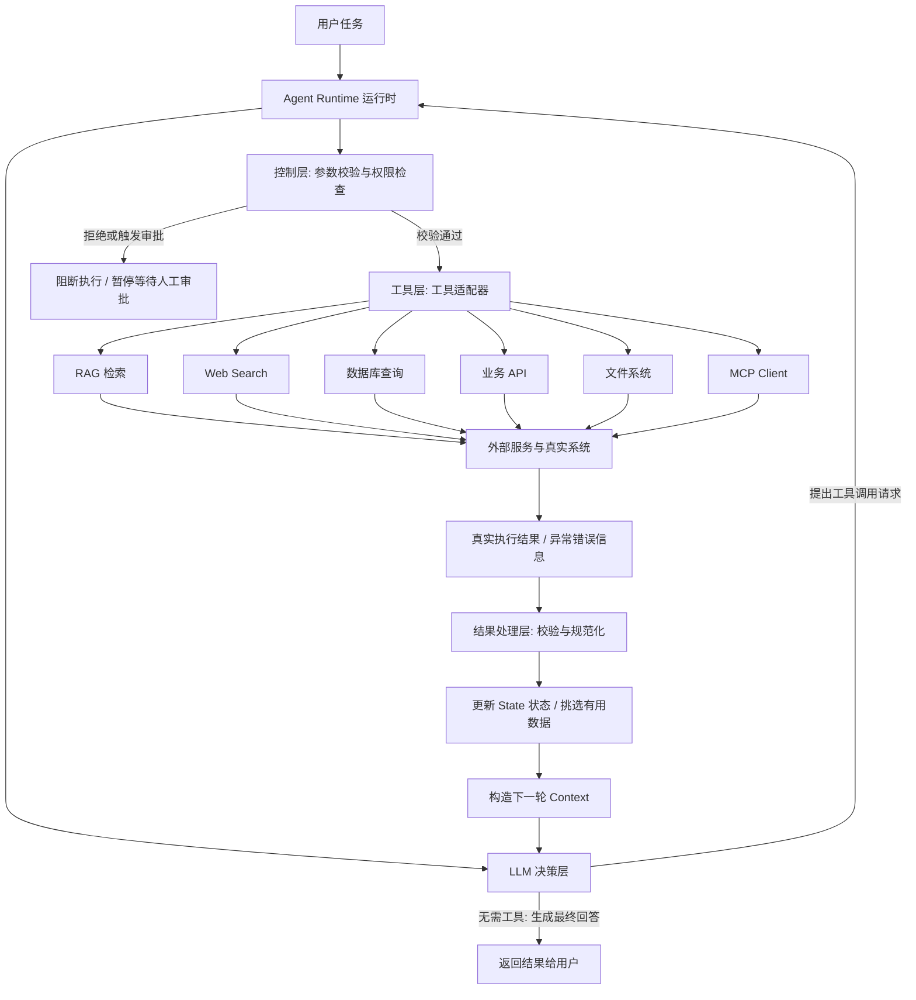

[[工具架构图.png]]

## 1 外部工具集成的基本认知与核心定位

### 1.1 外部工具集成解决的核心问题

大语言模型（LLM）在理解自然语言、推理分析和生成文本方面具备强大能力，但模型本身无法直接感知实时外部世界，也不具备直接操作外部系统的物理权限。当自主智能体（Agent）需要查询最新的实时信息、访问企业内部私有数据、读取本地文件或在业务系统中修改数据时，必须通过外部工具集成（External Tool Integration）机制来拓展其能力边界。

外部工具集成解决的根本问题是：打破大语言模型的静态知识局限与环境隔离状态，建立一套可控、安全、可靠的通道，使智能体能够连接并驱动外部软件系统与数据源。

### 1.2 典型外部能力扩展场景

在实际 AI 应用开发中，智能体通常需要接入以下六类典型的外部能力：

1. **企业 RAG 知识库**：检索私有文档、规章制度、技术规范或历史工单。
2. **Web Search（网络搜索）**：获取互联网上的实时新闻、网页动态与最新公开资料。
3. **数据库系统**：查询客户信息、订单记录、库存数据或统计报表。
4. **业务 API 接口**：创建业务工单、发送通知邮件、发起支付或调用内部微服务。
5. **文件系统**：读取项目源代码、解析本地配置文件、写入生成报告或处理数据表格。
6. **MCP（Model Context Protocol）服务**：通过标准化协议接入已暴露能力规范的远程或本地服务。

### 1.3 工具集成的基本工程原则

在进行外部能力集成时，必须建立一个核心工程认知：

外部工具集成绝不是简单地将第三方 API 接口直接暴露给大语言模型，而是将复杂的外部系统能力，封装转换成智能体能够安全发起请求、确定性执行、并能规范处理返回结果的标准化接口。

## 2 外部工具集成的四层架构与运行闭环

### 2.1 工具接入的四层架构设计

为了保证智能体运行的稳定性与安全性，外部工具集成机制在架构上必须进行明确的分层设计，划分出决策、控制、工具与结果处理四层职责。

| 架构层次 | 担当角色 | 核心职责 | 核心回答的问题 |
| ------ | ------ | ------ | ------ |
| **决策层** | LLM（大语言模型） | 根据当前任务目标与上下文，提出工具调用请求及参数 | 下一步应该做什么？应该调用哪个工具？ |
| **控制层** | Runtime（运行时） | 组织流程执行，实施参数结构校验、权限检查、人工审批与终止控制 | 当前这项工具调用请求是否允许被执行？ |
| **工具层** | 工具适配器（Adapters） | 连接实际外部系统，发起网络通信、数据库查询或文件读写 | 如何向外部系统发送指令并获取真实返回值？ |
| **结果处理层** | 结果治理模块 | 校验工具返回值、记录操作日志、更新 State，并将有效数据拼装为 Context | 工具执行是否成功？哪些返回数据需要提交给模型？ |

### 2.2 工具调用的闭环流转流程

智能体在集成外部工具时的完整闭环运行流转如下：

### 2.3 控制层与决策层的认知防线

在工具集成的架构设计中，开发者必须建立两道严密的认知防线：

1. **模型提出请求不等于物理执行**：LLM 只能生成包含工具名称与参数的结构化文本（Tool Call），真正的物理调用必须由 Runtime 在通过安全校验后代为执行。
2. **工具返回成功不等于任务完成**：单个工具接口成功返回数据，仅代表该原子操作完成，并不代表用户的终极任务已经解答完毕。系统仍需将结果提交给决策层继续评估。

## 3 工具（Tool）与上下文（Context）的本质区别与权衡

### 3.1 Tool 与 Context 的对比辨析

在 AI 应用开发中，区分“什么应该封装成 Tool”与“什么应该直接放入 Context”是优化 Token 成本、提升响应速度与保证决策质量的关键。

| 对比维度 | Tool（工具） | Context（上下文） |
| ------ | ------ | ------ |
| **本质属性** | 可以被调用的能力、方法或操作接口 | 模型在当前单次推理中可调用的高信号密度信息 |
| **核心作用** | 动态主动查询信息、执行计算、修改系统状态 | 为模型的逻辑分析与决策提供即时依据 |
| **典型内容** | 检索函数、订单查询接口、文件读取方法 | 用户提问、相关文档片段、历史摘要、工具执行结果 |
| **是否直接执行操作** | 是（物理执行代码、通信或数据变更） | 否（仅作为静态信息输入，不触发副作用） |
| **生命周期** | 被发起调用时动态触发执行 | 随单次 LLM API 调用生成，可动态更新与销毁 |

### 3.2 独立 Tool 封装的判断标准

当某项能力或数据满足以下条件时，应当将其封装为独立的 Tool：

1. **涉及实际物理操作**：需要查询数据库、读写磁盘文件、发送 HTTP 请求或更改外部状态。
2. **海量数据无法直接全量载入**：数据量超出模型窗口，或包含大量无关噪声（如数十万篇文档的知识库）。
3. **需要复用且可独立测试**：具备明确的业务逻辑，可以在无大模型参与下独立进行单元测试。
4. **必须实施前置拦截**：需要在执行前进行严格的输入参数校验、租户权限隔离或人工审批。
5. **需要统一的容错管理**：需要对网络超时、服务降级、失败重试及结果校验建立程序化防御。

如果数据极其简单、无副作用且已被用户直接提供（例如用户在提问中直接粘贴的一段短文本），则应直接放入 Context，无需额外开发工具。

### 3.3 六类外部能力的封装与 Context 划分矩阵

| 外部能力类型 | 推荐封装的 Tool 接口 | 适合选入 Context 的数据内容 |
| ------ | ------ | ------ |
| **RAG 知识库** | 知识库检索工具、文档全文拉取工具 | 经过相关性筛选与重排后的高价值文档片段及来源标识 |
| **Web Search** | 网页搜索工具、网页正文提取工具 | 与当前任务直接相关的搜索结果摘要、核心网页片段 |
| **数据库** | 客户信息查询接口、订单受控查询接口 | 数据库查询返回结果中满足当前任务所需的必要字段 |
| **业务 API** | 工单创建接口、订单状态变更接口 | API 响应的操作状态、业务流水号、操作结果反馈 |
| **文件系统** | 受限目录文件读取工具、文件写入工具 | 决策所需的目标文件段落、格式化解析数据、写入结果 |
| **MCP 服务** | 通过 MCP Client 调用的远程 Tool 或 Resource | 通过 MCP 协议获取并经过筛选后的标准化资源与数据 |

### 3.4 能力类型与连接协议（MCP）的层次位阶区别

在理解工具分类时，需要澄清一个常见的概念混淆：

RAG、Web Search、数据库、业务 API 与文件系统属于**能力类型**；而 MCP（Model Context Protocol，模型上下文协议）属于**标准化连接协议**。MCP 并不是一种独立于上述能力之外的新型数据源，而是提供了一套统一的通信标准，用于将上述各类能力以规范化的形式暴露给智能体。

## 4 高质量 Tool 接口的设计规范

### 4.1 接口规范的八大设计要素

一个具备生产级可靠性的 Tool 接口，绝不仅仅是一个简单的函数，而必须包含以下八个维度的完整设计：

1. **名称（Name）**：具备明确语义的标识符，清晰表达工具的核心用途。
2. **描述（Description）**：详细说明工具的适用场景、功能边界与调用建议，供模型判断是否选用。
3. **输入 Schema（Input Schema）**：使用 JSON Schema 明确定义参数名称、数据类型、必填项与取值约束。
4. **执行逻辑（Execution Logic）**：严谨的底层代码，负责与真实外部服务通信。
5. **权限边界（Permission Boundary）**：硬性代码逻辑，限制当前用户能够操作的数据范围。
6. **超时与重试（Timeout & Retry）**：明确超时阈值，并区分可重试错误（如网络瞬断）与不可重试错误（如参数越权）。
7. **返回结果（Return Result）**：采用统一的结构化数据模型表示成功响应或异常错误。
8. **可观测性（Observability）**：记录完整的调用耗时、输入参数、执行结果与错误日志，用于追溯审计。

### 4.2 统一工具结果（ToolResult）数据模型

为了让 Runtime 能够以一致的方式处理不同外部工具的返回值，建议在工程层面建立统一的工具结果数据模型。该模型包含以下核心字段：

* **执行成功状态（success）**：布尔值，标识工具物理执行是否成功。
* **业务数据内容（data）**：任意结构化数据，存储工具执行成功时返回的核心业务数据。
* **错误代码（error_code）**：字符串，当执行失败时返回标准的系统错误码。
* **错误信息（error_message）**：字符串，提供人类及模型可读的详细故障原因。
* **重试标识（retryable）**：布尔值，指示 Runtime 是否可以自动发起原样重试。
* **扩展元数据字段**：包含全局请求 ID、执行耗时、数据来源标识、分页信息及安全审计标签。

### 4.3 统一结果结构与业务独立校验的分离原则

统一的工具结果模型使控制层能够用标准化的流程进行错误捕获与日志记录。然而，统一结构并不意味着所有工具的内部逻辑一致。每个工具适配器必须根据底层业务系统的特性实施独立的硬性校验。例如，数据库查询接口必须在工具内部校验当前用户的租户 ID，而不能仅仅依赖 Runtime 校验参数格式是否为字符串。

## 5 工具集成的权限控制与安全边界

### 5.1 过度代理权限（Excessive Agency）风险与最小权限原则

智能体系统面临的重要安全风险之一是“过度代理权限（Excessive Agency）”。该风险源于工具功能过于宽泛、授予底层的物理权限过大，或智能体的自主决策程度超出了业务实际需求。

为了应对该风险，必须严格贯彻**最小权限原则（Principle of Least Privilege）**：

1. **凭据与角色隔离**：只读查询任务仅分配只读数据库账号或受限 API Token，不得为了开发省事而直接使用高权限管理员凭据。
2. **接口颗粒度收紧**：将宽泛的数据库 SQL 执行接口，收窄为具备特定业务逻辑的受限 API（如仅允许根据订单 ID 查询单个订单）。
3. **敏感信息拦截**：严格禁止向模型输入传递数据库连接密码、第三方密钥或未经鉴权的访问令牌。
4. **人机协作审批（Human-in-the-Loop）**：对涉及删除数据、转账支付、修改生产配置等高风险副作用操作，必须建立强制的阻断等待与人工确认节点。
5. **程序强制校验**：所有的权限隔离与访问控制必须由底层业务服务与 Runtime 在代码层强制执行，绝不能仅仅写在 Prompt 提示词中要求模型“自我约束”。

### 5.2 六类外部工具的核心安全防御手段

| 工具类型 | 必须重点防御的安全风险 | 生产级核心安全手段 |
| ------ | ------ | ------ |
| **RAG 知识库** | 文档访问越权、跨用户数据泄露、检索内容中的恶意提示词注入（Prompt Injection） | 数据库硬性租户隔离、检索切片权限过滤、将检索内容声明为不可信数据区 |
| **Web Search** | 不可信第三方网页内容、虚假诱导信息、恶意外部链接 | 域名白名单过滤、提取纯文本清洗标签、拦截网页中的系统级指令 |
| **数据库系统** | 越权查询、未授权修改、SQL 注入攻击 | 严格使用参数化查询（Parameterized Queries）、分配只读数据库账号、强制租户 ID 绑定 |
| **业务 API** | 伪造用户身份、越权调用、重复调用产生副作用 | 校验 API 鉴权 Token、引入幂等性锁、对敏感写操作引入人工审批 |
| **文件系统** | 路径越权、目录穿越（Directory Traversal）、敏感配置文件泄漏 | 路径规范化校验（Canonicalization）、限制可读写基准目录、禁止访问系统关键文件 |
| **MCP 服务** | 不可信 MCP Server、暴露能力超出预期、下游越权 | 建立 Server 来源白名单、严格审查暴露的 Tool Schema、限制下游通信凭据 |

## 6 工具返回数据的上下文（Context）转化与治理

### 6.1 工具结果进入 Context 的六步处理流转

工具返回的原始数据往往包含大量接口冗余信息、技术元数据或敏感字段。不能将其无脑直接注入模型上下文，必须经过以下六步治理流转：

### 6.2 字段筛选与敏感数据脱敏

以查询客户信息的数据库工具为例，底层接口返回的原始数据可能包含：客户 ID、姓名、历史订单数、内部敏感备注以及支付鉴权 Token。

在将该数据转化为 Context 时，治理模块应当：

* **精简保留**：仅提取当前决策所需的字段（如客户 ID、订单数）。
* **严格拦截**：物理剔除与当前任务无关的敏感数据（如支付鉴权 Token、密码哈希）。
* **去重与格式化**：抹去接口内部的状态码、网络耗时等开发调试字段，将其整理为高信息密度的结构化文本。

### 6.3 异常数据与边界情况的处理机制

物理工具在真实环境中运行，不可避免会遇到各类边界异常。工具结果治理层必须具备对以下五种异常场景的优雅容错机制：

1. **物理执行超时**：向模型返回标准的超时提示，指导模型决定是降低参数范围重试，还是切换备用工具。
2. **无匹配数据返回**：返回明确的“未找到相关记录”状态，防止模型将空结果误判为系统故障或凭空幻觉。
3. **部分数据缺失**：保留有效字段并明确标记缺失项，支持模型在部分信息下进行降级推理。
4. **服务完全不可用**：返回明确的工具服务故障信息，引导智能体向用户解释情况或寻找替代方案。
5. **数据格式异常**：捕获解析错误，阻断坏数据进入上下文，保障智能体主循环的稳定运行。
