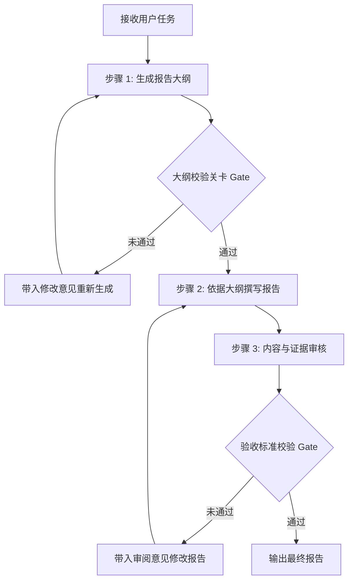
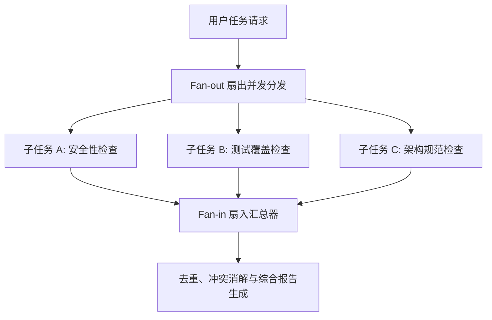
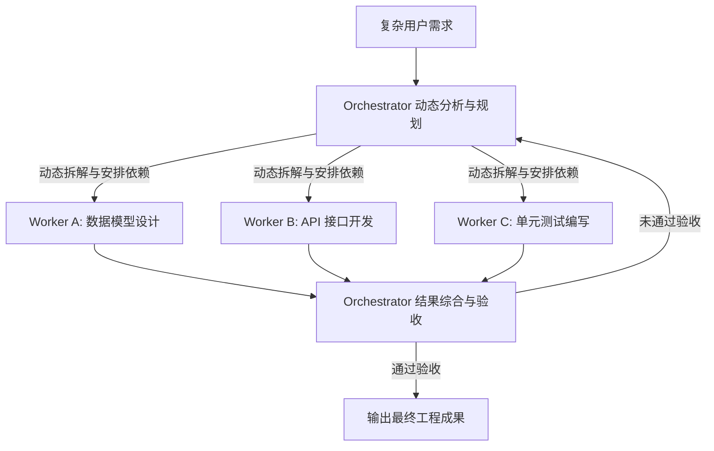
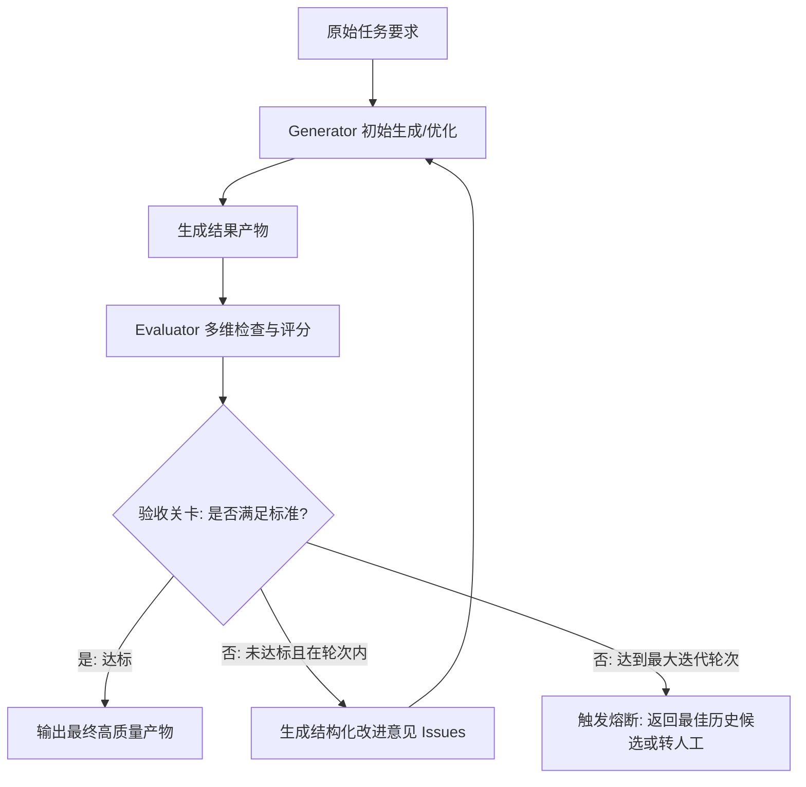
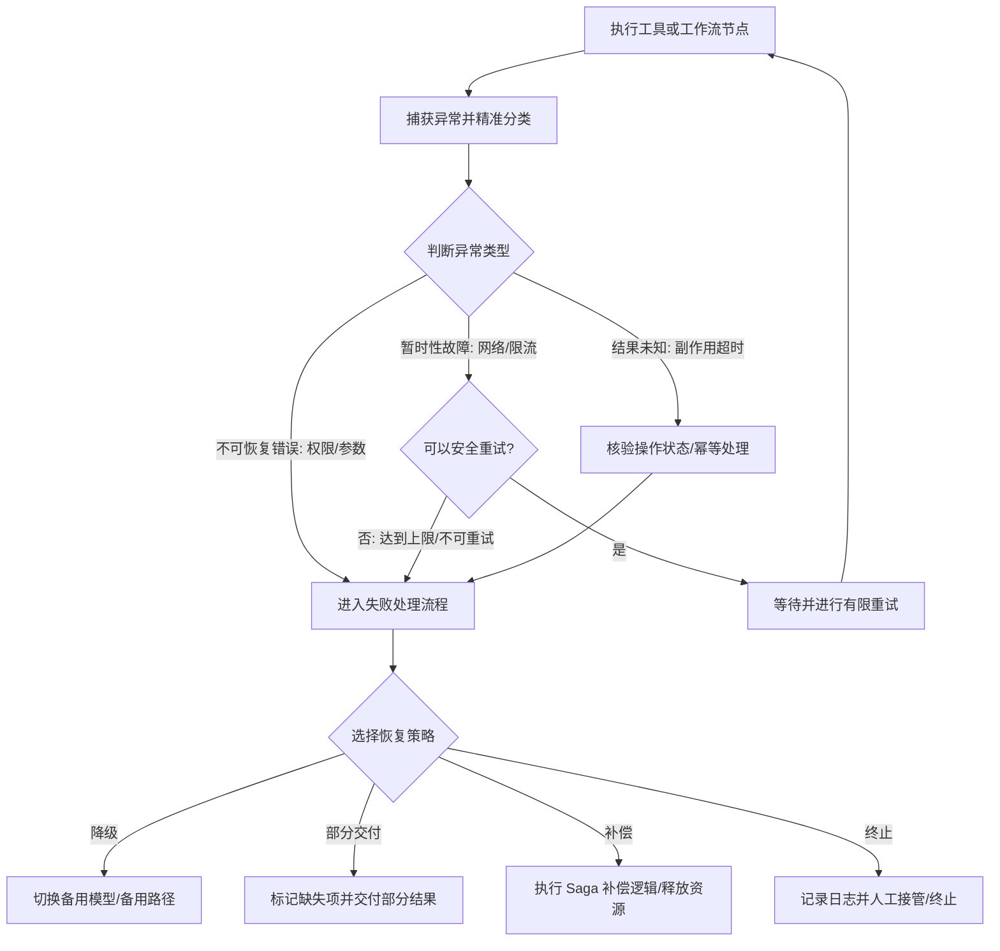
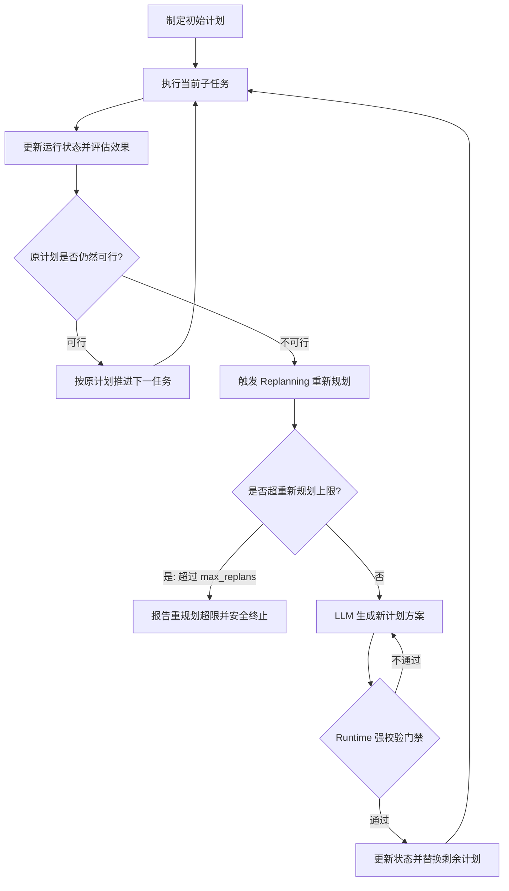

## 2 五大核心工作流编排范式

### 2.1 Prompt Chaining（提示词链式编排）

#### 2.1.1 核心定义与背景
 Prompt Chaining（提示词链式编排）是一种将复杂任务拆解为一系列按固定顺序执行的 LLM 调用步骤的工作流模式。每次 LLM 调用仅处理其中一个特定步骤，并将该步骤的输出作为后一步骤的输入，中间可嵌入程序化校验与控制逻辑。

其本质在于**化繁为简与职责分离**：避免要求大模型在单次调用中完成确定结构、收集资料、撰写内容、质检审查等多个异质任务，从而降低模型的认知负荷，提高输出稳定性与可测试性。

#### 2.1.2 基本架构与数据流转
Prompt Chaining 的运行依赖于程序预先定义的流程图与明确的上下文传递。
[[Prompt Chaining 的基本架构.png]]

#### 2.1.3 与普通多次调用的本质区别

| 对比维度 | 普通多次 LLM 调用 | 设计良好的 Prompt Chaining |
| ------ | ------ | ------ |
| **步骤职责** | 边界模糊，多任务混杂 | 步骤单一，职责明确 |
| **数据传递** | 依赖人工拼接或无序上下文 | 建立明确的前后输入输出数据契约 |
| **输出规范** | 自然语言自由输出 | 严格的结构化数据格式约束 |
| **中间校验** | 缺乏针对性检查点 | 设置关卡（Gate）校验字段、结构与业务逻辑 |
| **失败处理** | 容易忽略失败直接推进 | 具有针对特定步骤的重试、修正与终止路径 |
| **可测试性** | 难于定位错误环节 | 支持针对单个步骤节点独立单元测试 |

#### 2.1.4 四大关键设计要素

1. **单职责任务拆解**：每个步骤仅聚焦单一任务。对于 JSON Schema 格式校验、必填字段检查等确定性逻辑，应优先使用硬编码程序而非 LLM。
2. **步骤间数据契约**：使用强类型结构化数据（如严格 JSON 字典）代替不受约束的自然语言传递，确保下游步骤能稳定解析上游产出。
3. **检查关卡（Gate）机制**：在关键步骤之间插入程序规则或 LLM 辅助评估关卡。未通过关卡时拒绝进入下一阶段，防止低质量中间结果污染下游。
4. **错误分支与终止边界**：明确规定步骤失败时的应对策略（如有限重试、退回上一步、触发降级或安全终止），设置最大重试上限以防止无限循环。

#### 2.1.5 适用与不适用场景

* **适合场景**：任务可清晰拆解为顺序依赖步骤，每一步有明确输入输出与验收标准的场景（如“大纲生成 → 初稿撰写 → 内容审核”、“需求解析 → 结构化提取 → 格式校验”）。
* **不适合场景**：简单单步任务，或行动路径无法预先确定、需根据环境反馈高度动态探索的场景。

#### 2.1.6 提示词链与自主 Agent 的区别

* **执行拓扑**：提示词链的执行顺序主要由预定义代码固定，步骤边界清晰；自主 Agent 的执行路径由 LLM 根据环境反馈实时决策。
* **架构选择原则**：能提前固定流程的优先使用 Prompt Chaining（高确定性、低成本、易调试）；只有需要路径探索与动态决策时才引入自主 Agent。

### 2.2 Routing（路由编排）

#### 2.2.1 核心定义与解决的问题
Routing（路由编排）是指根据输入请求的内容特征或中间执行状态，将任务分配给不同专有处理路径的编排模式。它解决的核心问题是**分类分发与专业化隔离**，避免用一套通用 Prompt 或工具列表应对差异巨大的业务请求。

#### 2.2.2 路由判断依据与分类机制

| 判断依据 | 典型场景 | 典型实现机制 |
| ------ | ------ | ------ |
| **用户请求类型** | 区分代码问题、退款请求、文档总结 | 规则匹配、分类模型或 LLM |
| **请求内容特征** | 是否包含订单号、技术复杂度、敏感度 | 规则正则表达式、条件校验、LLM 分类 |
| **中间执行状态** | 检索是否命中、阈值得分、置信度 | 条件分支、数值阈值判断、LLM 评估 |

#### 2.2.3 规则路由与 LLM 路由的混合设计

* **规则路由**：由硬编码逻辑按明确条件分发。优点是确定性强、零模型开销、毫秒级响应；局限是难以覆盖自然语言的多样表达。
* **LLM 路由**：由 LLM 语义理解后输出结构化分类结果。优点是能识别复杂语义与隐式意图；局限是存在误分类概率且增加延迟与 Token 成本。
* **工业级混合路由**：优先通过程序规则捕获确定性特征，无法确定的复杂语义交给 LLM 路由，LLM 的输出结果必须通过程序映射到预定义的合法路径集合中。

#### 2.2.4 规范路由流程与兜底机制

路由流程应包含以下 5 个步骤：
1. **接收输入**：提取原始请求与必要上下文。
2. **路由判定**：运行规则或 LLM 获取候选分类。
3. **合法性校验**：检查分类结果是否属于系统预定义的合法分支路径。
4. **任务分发**：将请求调度至已注册的专属处理流程。
5. **异常兜底（Fallback）**：当分类无匹配、LLM 输出非法类别或条件缺失时，自动转入兜底路径（如通用问答流程或人工澄清分支），拒绝盲目执行未知路径。

#### 2.2.5 适用场景与安全边界

* **适用场景**：输入存在清晰类型区别且各类型处理逻辑、Prompt 或工具列表完全不同的场景（如智能客服分流、RAG 检索状态分流）。
* **安全边界**：路由分发仅决定执行路径，不能替代权限校验。目标路径仍需独立校验用户的身份与操作授权。

### 2.3 Parallelization（并行编排）

#### 2.3.1 两种核心模式：Sectioning 与 Voting

并行编排利用 Fan-out / Fan-in（扇出 / 扇入）架构，将无数据依赖的任务并发执行，最后进行结果汇总。

1. **Sectioning（任务拆分并行）**：将一个大任务拆分为多个互不依赖的子任务同时执行，旨在**缩短端到端耗时与实现关注点分离**（如同时对项目进行“安全检查”、“测试覆盖检查”与“架构检查”）。
2. **Voting（多次执行与投票）**：对同一个任务发起多次独立的 LLM 调用，通过投票、对比或裁判模型汇总结果，旨在**克服单次生成的随机性与提高结果置信度**。

| 维度 | Sectioning（任务拆分） | Voting（多次投票） |
| ------ | ------ | ------ |
| **执行内容** | 异质的子任务 | 同一任务的多次独立尝试 |
| **核心目标** | 缩短并发耗时，专业化分工 | 消除偶发错误，提高决策可靠性 |
| **结果汇总方式** | 结构化拼接与去重合并 | 多数表决、高置信度筛选或合成 |
| **典型场景** | 多维度质量检查、多源数据并行检索 | 敏感决策二次校验、候选代码筛选 |

#### 2.3.2 扇出/扇入（Fan-out / Fan-in）基本架构

#### 2.3.3 四大核心工程挑战

1. **任务独立性校验**：若子任务 B 依赖子任务 A 的输出，则决不能强行并行，必须拆分为“阶段内并行，阶段间串行”。
2. **结果汇总与去重（Fan-in）**：分支返回的内容可能存在重复、矛盾或格式不一致，必须建立强类型的汇总规则与冲突消解逻辑。
3. **部分失败策略（Partial Failure）**：并发分支中部分节点超时或报错时，应支持使用部分成功结果并标记缺失项，而非一刀切导致全局崩溃。
4. **资源与成本开销**：并行降低了端到端延迟，但增加了并发 Token 消耗与 API 限流风险，必须设置最大并发数限制（Concurrency Limits）。

### 2.4 Orchestrator-Workers（编排器—工作者模式）

#### 2.4.1 核心定义与三大组件职责

Orchestrator-Workers 是一种由中央编排器动态规划、拆解子任务，分发给专有工作者执行，最后由编排器汇总综合的编排范式。

* **Orchestrator（中央编排器）**：分析复杂目标，根据输入特征**动态生成**子任务清单并建立依赖顺序。
* **Workers（执行工作者）**：在受限的工具与作用域内，独立完成分配的单一子任务。
* **Synthesis（结果综合器）**：检查所有 Workers 的产出，识别冲突与依赖遗漏，生成最终汇总成果。

#### 2.4.2 与普通 Parallelization 的关键区别

| 对比维度 | Parallelization（普通并行） | Orchestrator-Workers（编排器—工作者） |
| ------ | ------ | ------ |
| **子任务划分** | **静态预定义**：开发者硬编码分支 | **动态生成**：编排器根据具体输入实时规划 |
| **工作者种类** | 固定（如固定 A/B/C 三个检查项） | 动态增减（根据任务需求决定工作者数量与职责） |
| **适用场景** | 流程已知、结构固定的并发任务 | 复杂度高、涉及文件或改动范围无法预知的任务 |

#### 2.4.3 动态规划与执行关键约束

1. **任务计划强结构化**：编排器输出的 Task 表格必须包含 `task_id`、`dependencies`、`output_requirements`，严禁自然语言模糊分发。
2. **工作者沙箱边界**：严格限制单个 Worker 的文件读写范围与工具权限，防止Worker 越权修改全局代码。
3. **确定性验收与防重试爆炸**：汇总不能仅依赖 LLM “宣称完成”，应结合静态检查与自动化测试；对失败 Worker 设置有限重试与最大重规划轮次（`max_replans`）。

### 2.5 Evaluator-Optimizer（评估器—优化器模式）

#### 2.5.1 核心架构与质检闭环

Evaluator-Optimizer 通过“**生成（Generator） → 评估（Evaluator） → 反馈（Feedback） → 优化（Optimizer）**”的循环迭代，实现输出质量的自驱动提升。

#### 2.5.2 多维评价标准与三种评估方式

评估器必须依据具体的**评价标准（Evaluation Criteria）**输出定位精准的改进建议，常见评估方式包括：
1. **程序/规则评估**：用于 JSON Schema 校验、编译检查、单元测试等硬性指标，最具客观性。
2. **LLM 评估**：用于审查逻辑连贯性、内容完整性、证据支持度等自然语言语义指标。
3. **人工评估（Human-in-the-Loop）**：用于高风险、高敏感业务的最终把关。

#### 2.5.3 结构化评估结果设计

评估器必须输出结构化的反馈对象（包含 `passed` 状态、各维度 `score` 以及包含缺陷严重程度 `severity` 与对应修改建议 `suggestion` 的 `issues` 列表），严禁仅输出模糊的自然语言点评。

#### 2.5.4 完整闭环控制与终止策略

为防止无限优化循环，系统必须配置：硬性通过门槛、针对严重缺陷的“一票否决”规则、最大迭代轮次上限（如 3 轮），以及**质量回退保护**（当新轮次得分下降时，自动保留并返回历史最高得分版本）。

#### 2.5.5 五大编排范式选型矩阵

| 编排范式 | 核心机制 | 最佳适用场景 | 关键工程开销 |
| ------ | ------ | ------ | ------ |
| **Prompt Chaining** | 顺序依赖执行，中间关卡拦截 | 步骤清晰、前后有严格数据契约的任务 | 延时随着链长线性叠加 |
| **Routing** | 意图识别分流，专有路径处理 | 请求类型多样、处理逻辑差异巨大的场景 | 需要设计完备的兜底分支 |
| **Parallelization** | 扇出并发执行，扇入汇总去重 | 无依赖的子任务检查或多次投票校验 | 并行 API 成本与限流风险 |
| **Orchestrator-Workers** | 动态拆解任务，调度受控 Worker | 改动范围不确定、依赖复杂的开放式任务 | 协调与冲突消解逻辑极复杂 |
| **Evaluator-Optimizer** | 迭代评估反馈，自驱动优化 | 有明确质量验收标准的高要求创作/生成 | 多轮评估带来的 Token 成本翻倍 |

## 3 工作流控制机制（Workflow Control）

### 3.1 条件分支（Conditional Branching）

#### 3.1.1 明确条件与分支完整性
条件分支根据系统当前的状态（State）选择执行路径。设计条件分支时，条件表达式必须互斥且覆盖全集，包含正常分支、业务无结果分支与系统故障分支。

#### 3.1.2 故障路径与业务无结果路径的严格隔离
工程上必须严格区分**系统执行故障**（如网络超时、接口 500）与**业务未命中**（如检索成功但相似度未达标）：
* 系统故障应进入**重试或降级恢复分支**。
* 业务未命中应进入**查询改写或证据不足处理分支**，严禁将系统故障误判为业务未命中。

### 3.2 循环控制（Loop Control）

#### 3.2.1 循环机制与状态更新演进
循环控制用于在特定条件满足时重复执行特定步骤（如 RAG 检索无结果时改写查询重新检索）。**每次循环必须伴随状态（State）的有效更新**（如递增重试计数器、更新查询词历史），避免使用完全相同的参数在封闭状态下无意义重复。

#### 3.2.2 继续条件与终止条件的设计
循环必须同时具备明确的**继续条件**（如“证据不足”且“重试次数未达上限”）与**终止条件**（如“证据已充分”、“触发系统异常”或“达到最大循环轮数”）。

### 3.3 终止条件（Termination Conditions）

#### 3.3.1 六种典型终止状态

1. **成功完成（Success）**：产物满足全部硬性约束与质量门槛。
2. **业务无法完成（Unachievable）**：缺乏必要外部信息或证据不足，明确告知限制。
3. **达到执行上限（Limit Exceeded）**：达到最大循环轮数、工具调用次数或 Token 预算上限。
4. **超时终止（Timeout）**：超过整体工作流设定的全局截止时间（Global Timeout）。
5. **不可恢复错误（Fatal Error）**：触发鉴权失败、配置丢失等无法通过重试解决的错误。
6. **人工中断（Human Abort）**：在人机协作节点被用户显式取消。

#### 3.3.2 “成功完成”与“停止执行”的严密区分
工作流停止运行并不等于任务成功。当触发轮次上限或超时终止时，系统必须明确返回 `status = "incomplete"` 或 `"failed"` 状态，**严禁为了形式上的完成而将未达标的中间产物伪装为成功结果**。

## 4 异常分支、重试与失败恢复机制

### 4.1 三类问题的区分与治理

在智能体（Agent）与工作流工程实践中，系统无法保证每一次模型调用、工具执行或节点流转都成功。为了确保系统的鲁棒性，必须将执行过程中出现的异常精准分类并分别施加治理策略。

#### 4.1.1 执行异常
*   **现象**：网络请求超时、API 触发限流、数据库连接失败、服务无响应等物理层或网络层故障。
*   **治理策略**：采用捕获机制、有限重试、指数退避与降级处理。

#### 4.1.2 业务条件不满足
*   **现象**：知识库检索未命中相关文档、缺少必要输入参数、查询数据为空等。
*   **治理策略**：这属于正常的业务逻辑路径，绝不能误判为程序异常进行无意义的网络重试。应通过条件分支（如查询改写、补充信息或返回证据不足提示）进行引导。

#### 4.1.3 结果质量不合格
*   **现象**：大语言模型（LLM）生成的答案缺乏证据支持、代码未能通过单元测试、输出结构缺失关键字段等。
*   **治理策略**：应进入评估器-优化器（Evaluator-Optimizer）质检闭环进行反馈修正或重新规划，而非进行网络层重试。

### 4.2 异常分支的处理流程

一个成熟的执行节点不能只有执行成功与程序崩溃两种状态。节点在捕获异常后，必须根据错误类型选择对应的恢复机制或终止路径。

### 4.3 重试（Retry）机制与策略

重试是在特定失败发生后，再次尝试执行同一操作的机制。重试策略必须严格遵循接口契约，不能无差别重试。

#### 4.3.1 可重试与不可重试的判定矩阵

| 失败类型 | 是否允许重试 | 原因与处理建议 |
| ------ | ------ | ------ |
| **临时网络抖动/超时** | 允许重试 | 故障通常极短，重试可自动恢复（需限制最大次数） |
| **API 服务端限流（429）** | 允许重试 | 必须遵循服务端返回的退避建议时间重试 |
| **参数格式错误（400）** | 严格禁止 | 输入本身非法，原样重试必定持续失败，需先修正参数 |
| **权限不足/越权（401/403）** | 严格禁止 | 凭据非法或权限不足，重试无法解决，应直接拒绝 |
| **生成质量不合格** | 禁止网络重试 | 属于质量问题，应提交修改意见进入优化闭环 |
| **有副作用的操作超时** | 禁止盲目重试 | 操作可能已经在服务端成功执行，直接重试会导致重复动作 |

#### 4.3.2 有限重试与指数退避（Exponential Backoff）

为了防止重试请求压垮本已受损的服务端，生产环境必须使用指数退避算法并结合随机抖动（Jitter）：

$$d_n = \min(d_{\max}, d_0 	imes 2^{n-1})$$

*   $d_0$：初始等待时间（如 1 秒）。
*   $d_{\max}$：最大等待间隔（如 8 秒）。
*   $n$：当前重试序号。
*   **随机抖动**：在退避时间基础上叠加随机浮动，打散并发请求，避免大量重试在同一时间集中冲击外部服务。
*   **双重超时限制**：除了设置单次调用的超时时间外，整条工作流必须设置全局截止时间（Deadline），防止重试无限拉长总响应延迟。

#### 4.3.3 副作用（Side-Effects）防护与幂等性设计

当对支付、数据库写入、工单创建等具有副作用的操作进行重试时，网络超时仅代表客户端未在限定时间内收到响应，并不证明服务端未执行该动作。

*   **幂等键（Idempotency Key）**：所有写操作必须携带由客户端生成的业务唯一请求 ID。服务端在收到重复幂等键时，直接返回已有执行结果而非重新重复扣款或重复写入。
*   **状态核验**：在对超时操作发起重试前，优先调用查询接口核验前一次调用的真实执行状态。

### 4.4 失败恢复（Failure Recovery）的五大模式

当重试次数耗尽或遇到不可重试的故障时，系统必须启动失败恢复策略：

1.  **重试模式（Retry）**：针对短暂网络故障，在配额范围内重试。
2.  **降级与备用路径（Fallback）**：主模型服务不可用时，自动切换至备用模型或静态预设方案。
3.  **交付部分结果（Partial Results）**：在并行子任务中，若某非核心分支失败，汇总其他成功分支的成果，并在报告中明确标明缺失范围。
4.  **补偿操作（Compensation）**：对于包含多步写操作的分布式长事务（Saga 模式），当后续步骤失败且无法恢复时，按相反顺序执行明确的业务补偿动作（如取消库存预留）。
5.  **终止与人工接管（Human-in-the-Loop）**：高风险操作或无法自动恢复时，保存当前工作流快照，转交人工审查或安全终止。

## 5 动态重新规划机制（Replanning）

### 5.1 动态重新规划的核心定义与触发场景

动态重新规划（Replanning）是指智能体在执行任务过程中，根据获得的新信息、环境反馈或局部失败，动态调整后续任务步骤、执行顺序或整体策略的机制。

#### 5.1.1 触发 Replanning 的典型场景
*   **工具与资源失效**：原计划调用的外部 API 或工具不可用。
*   **假设不成立**：原计划假定存在的文件、数据或接口实际上不存在。
*   **前置依赖失败**：上游子任务无法完成，导致原定的下游任务链被完全阻塞。
*   **出现更优路径**：在执行中发现了比原计划更高效、更安全的替代方案。
*   **目标提前达成**：当前获得的信息已足够解答用户需求，原计划剩余步骤不再需要执行。

### 5.2 重试（Retry）、修正（Repair）与重新规划（Replanning）的区别

开发者必须严格区分三类不同层级的修复动作：

| 机制名称 | 改变的核心对象 | 典型应用场景 |
| ------ | ------ | ------ |
| **重试（Retry）** | 改变操作的**执行次数** | 搜索 API 遇到短暂网络抖动超时，重新发起相同请求 |
| **修正（Repair）** | 改变操作的**局部参数/格式** | 发现 API 提示 JSON 格式不规范，修改参数格式后再次调用 |
| **重新规划（Replanning）** | 改变**后续任务链与全局策略** | 搜索 API 彻底不可用，改为读取本地项目源码并分析配置文件 |

重新规划并非遇到任何错误就推倒重来，其本质是在保持原始目标与约束不变的前提下，重新制定尚未完成的路线图。

### 5.3 动态重新规划的标准流程

### 5.4 重新规划的工程设计与关键约束

#### 5.4.1 上下文传递模型
重新规划时，绝不能将原始用户请求重新抛给大模型从头开始。必须向 LLM 提供包含以下要素的结构化上下文：
*   **原始目标与硬性约束**：任务最终要达成的指标以及不可逾越的安全红线。
*   **已完成且验证的成果**：哪些子任务已经成功完成，其产出数据是什么（避免重复劳动）。
*   **当前系统状态与可用资源**：当前剩余的 Token 配额、时间预算与可用工具列表。
*   **失败轨迹与无效路径记录**：过去尝试过哪些方案、为什么失败，防止大模型陷入重复尝试同一错误方案的怪圈。
*   **剩余待解决子问题**：目前还缺少哪些关键拼图。

#### 5.4.2 新计划的程序级强校验门禁
大模型生成的新计划必须通过 Runtime 控制层的静态程序检查，满足以下条件后方可生效：
1.  **需求一致性**：新计划是否依然服务于原始目标，未擅自缩减核心交付范围。
2.  **权限与安全红线**：新计划不得试图绕过权限控制（如因测试失败而尝试删除测试目录）。
3.  **工具与依赖合法性**：新计划中的步骤必须仅使用系统当前已注册且可用的工具，且逻辑依赖关系无死锁。
4.  **资源预算约束**：新计划预估消耗的轮次与 Token 是否超出剩余的总配额。

### 5.5 综合案例：研究型 Agent 面对文档缺失的动态重规划

**原始任务**：调查某一开源 GitHub 项目的架构，输出核心模块、数据流与测试报告。

**初始计划**：读取 README → 查找架构设计文档 → 解析核心模块源码 → 检查单元测试 → 汇总报告。

**执行过程中的动态调整**：

| 发生状况 | 系统判断 | 采取的工程动作 | 是否触发 Replanning |
| ------ | ------ | ------ | ------ |
| GitHub API 请求短暂超时 | 暂时性网络故障 | 执行指数退避重试 | 不触发 |
| 搜索参数少传必填字段 | 格式不规范 | 修正参数并重新发起请求 | 不触发（属于 Repair） |
| 架构设计文档不存在（404） | 原计划前提不成立 | 标记该文档缺失，调整后续分析路线 | **触发 Replanning** |
| 源码结构与原假设完全不符 | 关键认知被翻盘 | 更新当前架构认知，重新调整分析重点 | **触发 Replanning** |
| 所有可用代码库均不可读 | 不可恢复故障 | 记录日志，输出已获取部分并转人工 | 终止执行 |

**重新规划后的替代计划**：读取项目目录结构 → 识别主入口文件（Entry point） → 解析模块间 Import 与调用关系 → 检查配置文件与测试用例 → 生成基于代码真相的架构图。

### 5.6 动态重新规划的工程控制原则

1.  **分层治理**：优先通过局部重试（Retry）与参数修正（Repair）解决局部小故障；仅在原计划前提失效或路线不可行时才启动重新规划（Replanning）。
2.  **上下文保护**：重新规划必须显式带入已完成成果与失败记录，严禁盲目清空历史从头开始。
3.  **Runtime 强控制**：大模型仅具备提出新计划的建议权，新计划的实际生效与调度必须经过程序控制层的安全与权限校验。
4.  **多重熔断保护**：必须显式设置最大重新规划次数（`max_replans`）、最大模型调用轮数、超时上限与 Token 成本预算，防止智能体在未知领域无限重规划导致费用失控。
